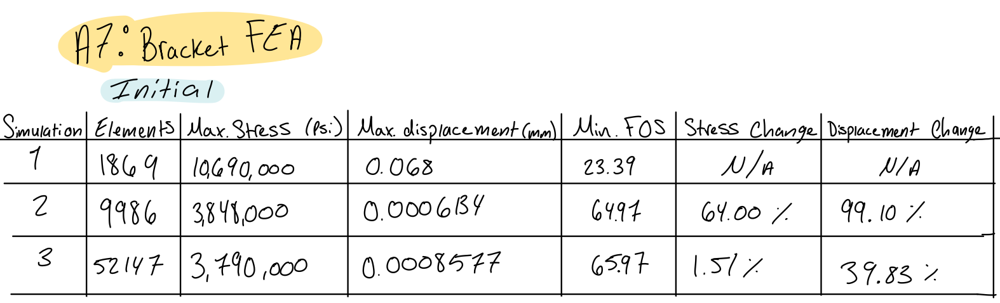
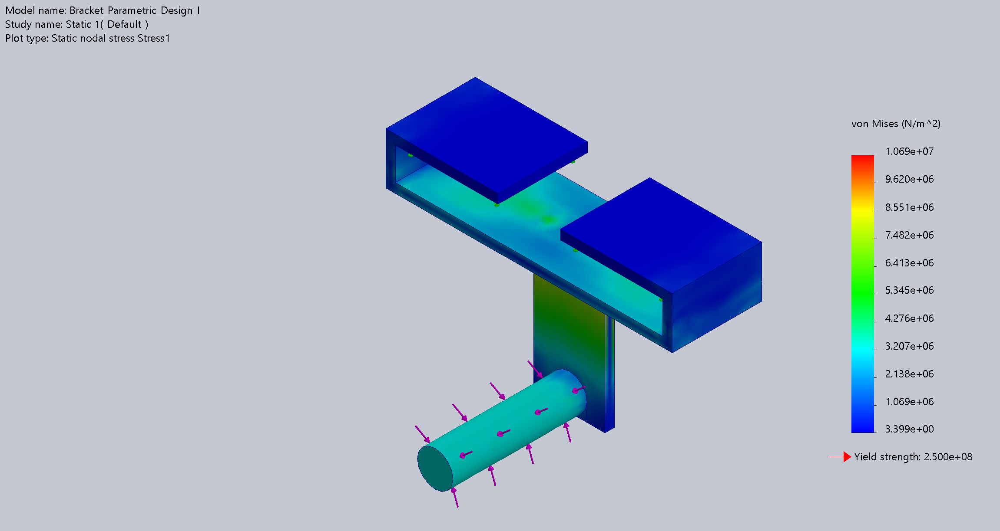
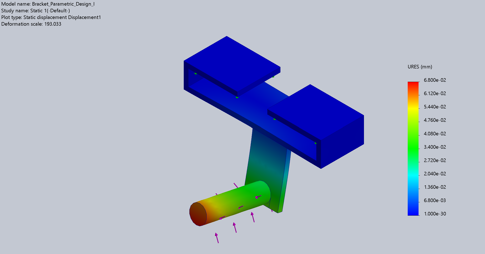
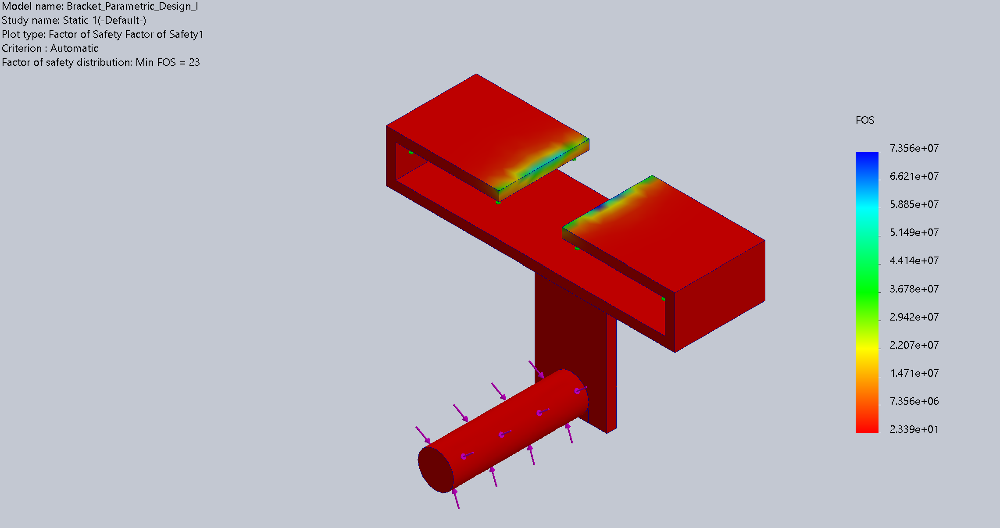
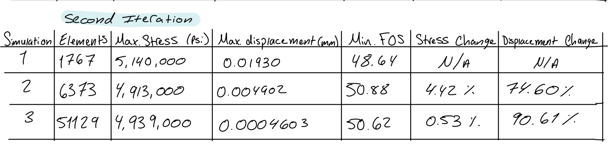
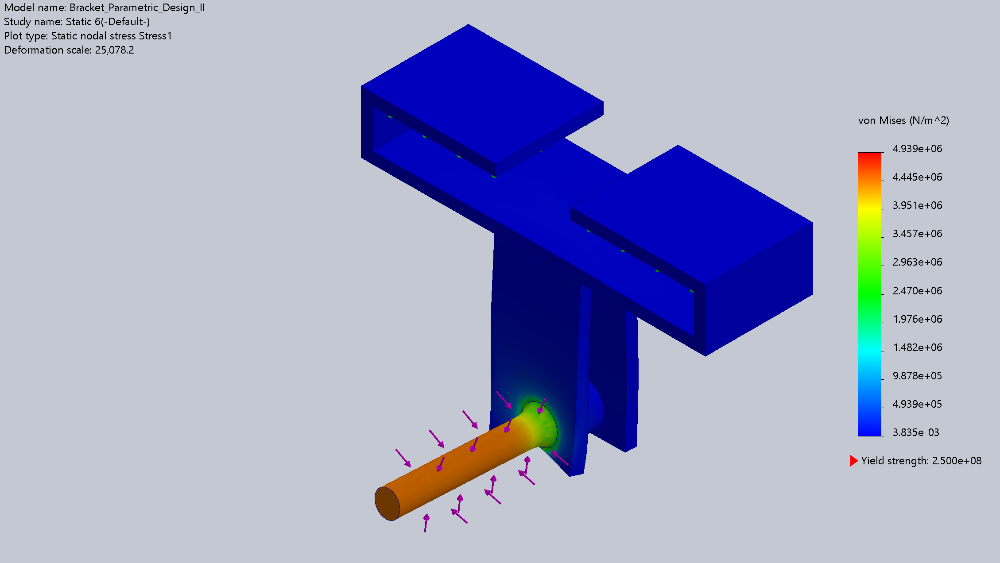
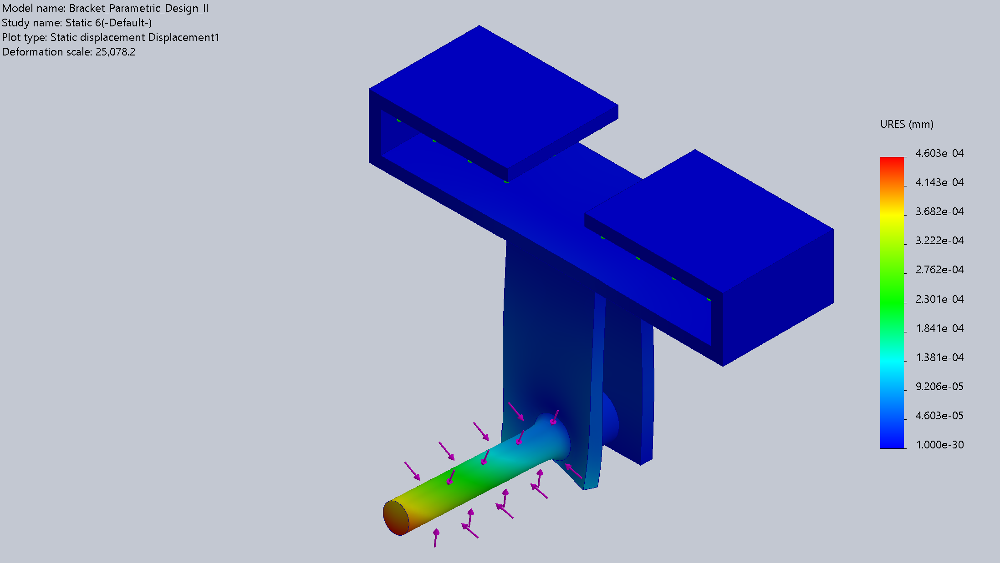
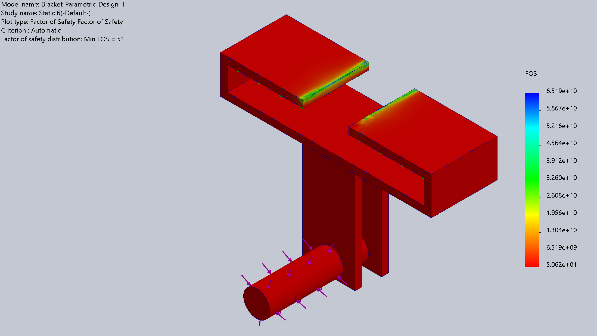

# A7 – [Topic]

## Objective

The objective of this assignment is to use finite element analysis (FEA) to improve the bracket design developed in Assignments #5 and #6. The goal is to create a bracket that balances strength, stiffness, and low mass while maintaining an appropriate factor of safety. Static stress simulations will be performed to evaluate maximum stress, maximum displacement, and safety factor. Mesh convergence will be checked by refining the mesh until the results differ by no more than 7%, or until three convergence attempts have been completed. At least three design iterations will be evaluated to determine how changes in geometry affect the bracket's structural performance.

### Design Requirements

The bracket was designed to attach to a rigid T-beam and hold a polyester strap. The updated T-beam specifications used for the interface were:

(a = 0.498) in

(b = 0.9992) in

(c = 1.499) in

The material selected for the bracket was A36 steel.

The material properties used in the previous analysis were:

Yield strength: (S_y = 36,000) psi

Elastic modulus: (E = 29,000,000) psi

Factor of safety: 4

Allowable stress: 9,000 psi

Maximum allowable deflection: 0.005 in

### Initial Bracket 

I started with my A5 bracket CAD model and used it as the initial FEA design. The original model included an upper mounting feature, a narrow drop-down arm, and a lower cylindrical support. The original bracket's calculated mass in SOLIDWORKS was 0.56 lb.

## Initial FEA Setup

I used a static study in SOLIDWORKS Simulation to evaluate my original A6 bracket design. First, I assigned A36 steel as the material and applied fixed geometry to the mounting faces where the bracket connects to the T-beam. This represents the bracket being restrained at its mounting connection.

.png>)

I then applied the 1,400 lbf downward force to the loading face on the lower cylindrical support to represent the force acting on the bracket. I kept the support and loading conditions consistent so I could compare the original design with my later design iterations.

.png>)

I generated an initial mesh and ran the static simulation to evaluate the maximum von Mises stress, maximum resultant displacement, and minimum factor of safety. I used these results as the baseline for evaluating how changes to the bracket geometry affected its structural performance and mass.

### Workflow and Mesh Validation

I started by running a static FEA study on my original A6 bracket design. I refined the mesh over three successive runs while keeping the geometry, material, fixtures, and applied load the same. This allowed me to check how mesh refinement affected the simulation results.

To check mesh convergence, I calculated the percent change between consecutive runs using:

$$
\text{Percent Change} =
\frac{|\text{New Result} - \text{Previous Result}|}
{|\text{Previous Result}|}
\times 100\%
$$

I compared the maximum von Mises stress, maximum resultant displacement, and minimum factor of safety for each mesh. The goal was to achieve a percent change of no more than 7% between consecutive runs, or complete three convergence attempts as required by the assignment. If the stress results did not converge within the three attempts, I recorded the results from the finest mesh.

After evaluating the original bracket, I used the simulation results to guide changes to the geometry. I repeated the analysis for three design iterations to compare how each design affected stress, displacement, factor of safety, and mass.

## Analyze

### Mesh Convergence

I performed mesh convergence testing on my original A6 bracket design to determine how mesh refinement affected the accuracy of the FEA results. I kept the geometry, material, fixtures, and applied load consistent while refining the mesh for each run.

I compared the results from each run to determine whether the stress results met the assigned 7% convergence requirement. I used the finest mesh results for my baseline comparison and documented whether convergence was achieved within the allowed attempts.

#### Design Iteration 1 — Original Bracket

I used my original A6 bracket as the baseline design. I evaluated the von Mises stress, resultant displacement, and factor of safety to identify areas of high stress and deformation. I also recorded the mass of the bracket to use as a reference when comparing the updated designs.

Mass: 0.56 lb

Maximum von Mises stress: 10,690,000 psi

Maximum resultant displacement: 0.068 mm

Minimum factor of safety: 23.39

#### Design Iteration 2 — Added a second arm

For the second design iteration, I added another support arm to the original bracket to evaluate how the additional structural support affected its performance under the applied load. The purpose of this change was to improve the bracket's stiffness and distribute the load across more of the structure. I then ran a static FEA study using the same material, fixtures, and applied load as the original design. I compared the maximum von Mises stress, maximum resultant displacement, minimum factor of safety, and mass to determine whether the additional arm improved the overall design.

- **Geometry change:** Added a second support arm.
- **Mass: 0.62 lb
- **Maximum von Mises stress: 5,140,000 psi
- **Maximum resultant displacement: 0.01930 mm
- **Minimum factor of safety: 46.21

### Design Iteration — Thicker Base

I increased the thickness of the bracket's base to evaluate how adding material to this area affected its structural performance. The goal was to improve stiffness and reduce deformation under the applied load. I kept the material, fixtures, and loading conditions consistent with the previous designs so I could compare the FEA results. I then evaluated the maximum von Mises stress, maximum resultant displacement, minimum factor of safety, and mass to determine whether the thicker base improved the bracket's performance enough to justify the additional material.

*Figure X. Bracket design with an increased base thickness.*

- **Geometry change:** Increased the thickness of the base.
- **Mass:** [Enter value] lb
- **Maximum von Mises stress:** [Enter value] psi
- **Maximum resultant displacement:** [Enter value] in
- **Minimum factor of safety:** [Enter value]
  

## Decide

## Communicate

