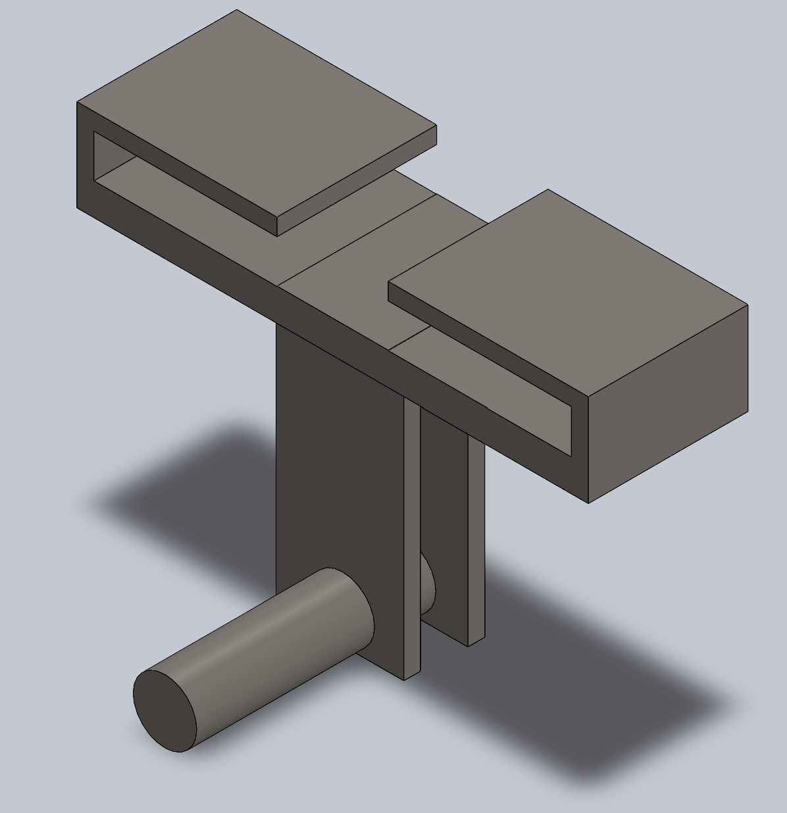
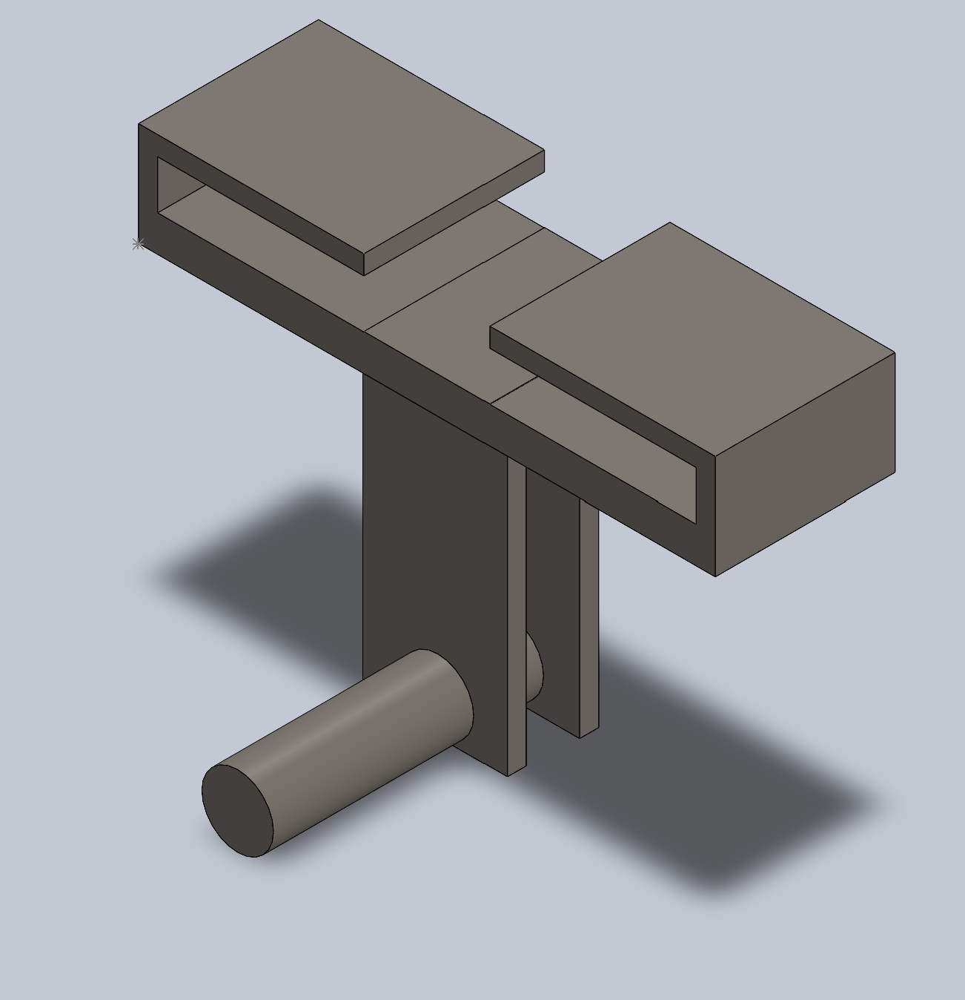
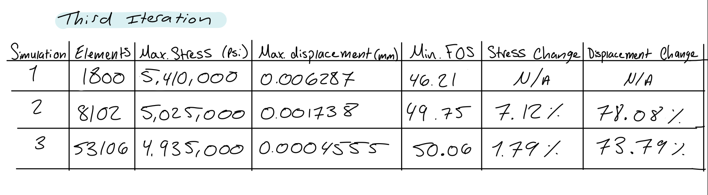
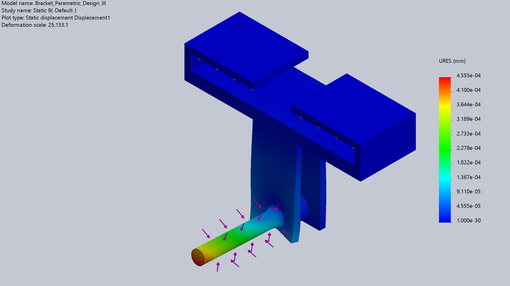
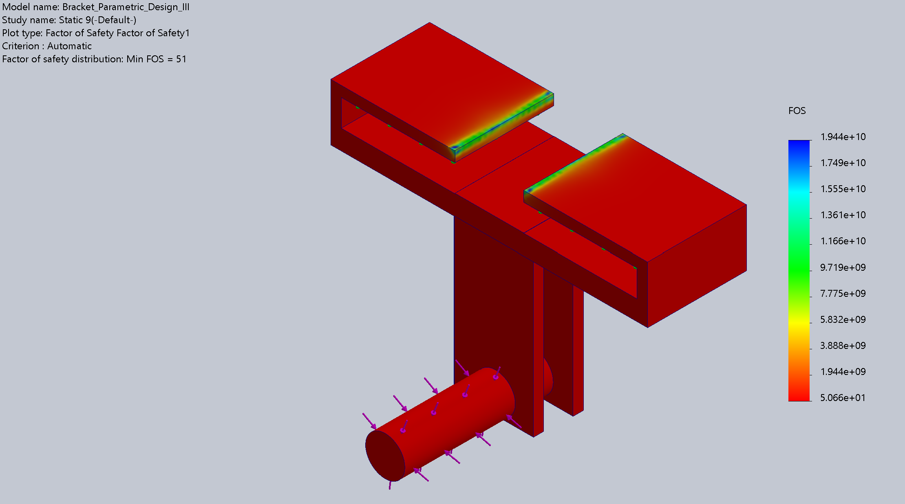
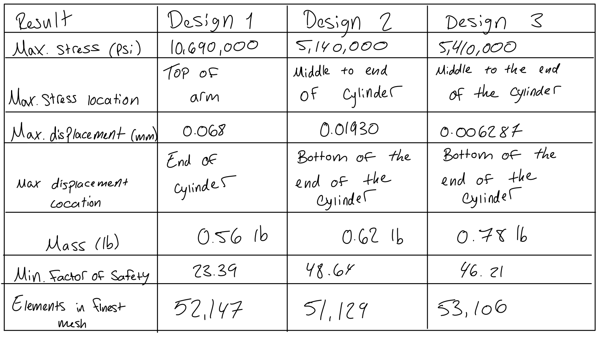
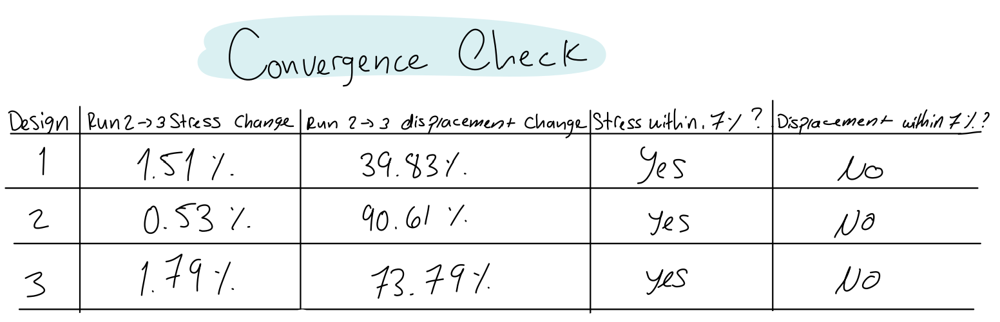

# A7 – [Topic]

## Objective

The objective of this assignment is to use finite element analysis (FEA) to improve the bracket design developed in Assignments #5 and #6. The goal is to create a bracket that balances strength, stiffness, and low mass while maintaining an appropriate factor of safety. Static stress simulations will be performed to evaluate maximum stress, maximum displacement, and safety factor. Mesh convergence will be checked by refining the mesh until the results differ by no more than 7%, or until three convergence attempts have been completed. At least three design iterations will be evaluated to determine how changes in geometry affect the bracket's structural performance.

### Design Requirements

The bracket was designed to attach to a rigid T-beam and hold a polyester strap. The updated T-beam specifications used for the interface were:

(a = 0.498) in

(b = 0.9992) in

(c = 1.499) in

The material selected for the bracket was A36 steel.

The material properties used in the previous analysis were:

Yield strength: (S_y = 36,000) psi

Elastic modulus: (E = 29,000,000) psi

Factor of safety: 4

Allowable stress: 9,000 psi

Maximum allowable deflection: 0.005 in

### Initial Bracket 

I started with my A5 bracket CAD model and used it as the initial FEA design. The original model included an upper mounting feature, a narrow drop-down arm, and a lower cylindrical support. The original bracket's calculated mass in SOLIDWORKS was 0.56 lb.

## Initial FEA Setup

I used a static study in SOLIDWORKS Simulation to evaluate my original A6 bracket design. First, I assigned A36 steel as the material and applied fixed geometry to the mounting faces where the bracket connects to the T-beam. This represents the bracket being restrained at its mounting connection.

.png>)

I then applied the 1,400 lbf downward force to the loading face on the lower cylindrical support to represent the force acting on the bracket. I kept the support and loading conditions consistent so I could compare the original design with my later design iterations.

.png>)

I generated an initial mesh and ran the static simulation to evaluate the maximum von Mises stress, maximum resultant displacement, and minimum factor of safety. I used these results as the baseline for evaluating how changes to the bracket geometry affected its structural performance and mass.

### Workflow and Mesh Validation

I started by running a static FEA study on my original A6 bracket design. I refined the mesh over three successive runs while keeping the geometry, material, fixtures, and applied load the same. This allowed me to check how mesh refinement affected the simulation results.

To check mesh convergence, I calculated the percent change between consecutive runs using:

**Percent Change (%) = (|New Result − Previous Result| / |Previous Result|) × 100**

I compared the maximum von Mises stress, maximum resultant displacement, and minimum factor of safety for each mesh. The goal was to achieve a percent change of no more than 7% between consecutive runs, or complete three convergence attempts as required by the assignment. If the stress results did not converge within three attempts, I recorded the finest-mesh results.

After evaluating the original bracket, I used the simulation results to guide geometry changes. I repeated the analysis for three design iterations to compare how each design affected stress, displacement, factor of safety, and mass.

## Analyze

### Mesh Convergence

I performed mesh convergence testing on my original A6 bracket design to determine how mesh refinement affected the accuracy of the FEA results. I kept the geometry, material, fixtures, and applied load consistent while refining the mesh for each run.

I compared the results from each run to determine whether the stress results met the assigned 7% convergence requirement. I used the finest mesh results for my baseline comparison and documented whether convergence was achieved within the allowed attempts.

#### Design Iteration 1 — Original Bracket

I used my original A6 bracket as the baseline design. I evaluated the von Mises stress, resultant displacement, and factor of safety to identify areas of high stress and deformation. I also recorded the mass of the bracket to use as a reference when comparing the updated designs.

Mass: 0.56 lb

Maximum von Mises stress: 10,690,000 psi

Maximum resultant displacement: 0.068 mm

Minimum factor of safety: 23.39

##### Design 1 – Discussion of Results and Changes

The original A6 bracket served as the baseline for comparing the three designs. At the finest mesh, the maximum displacement was [enter value] in, and the maximum von Mises stress was [enter value] psi. The minimum factor of safety was [enter value], and the bracket had a mass of 0.56 lb. These results provided a reference for evaluating whether the additional support and material in the next two designs improved the bracket's structural performance.

#### Design Iteration 2 — Added a second arm

For the second design iteration, I added another support arm to the original bracket to evaluate how the additional structural support affected its performance under the applied load. The purpose of this change was to improve the bracket's stiffness and distribute the load across more of the structure. I then ran a static FEA study using the same material, fixtures, and applied load as the original design. I compared the maximum von Mises stress, maximum resultant displacement, minimum factor of safety, and mass to determine whether the additional arm improved the overall design.

- Geometry change:** Added a second support arm.
- Mass: 0.62 lb
- Maximum von Mises stress: 5,140,000 psi
- Maximum resultant displacement: 0.01930 mm
- Minimum factor of safety: 46.21

##### Design 2 – Discussion of Results and Changes

Adding a second support arm was intended to improve the bracket's stiffness and help distribute the applied load across more of the structure. At the finest mesh, the maximum displacement was [enter value] in, and the maximum von Mises stress was [enter value] psi. The minimum factor of safety was [enter value], and the mass increased to [enter value] lb. Comparing these results with the original design showed whether the additional arm reduced deformation or stress enough to justify the increase in mass.

### Design Iteration — Thicker Base

I increased the thickness of the bracket's base to evaluate how adding material to this area affected its structural performance. The goal was to improve stiffness and reduce deformation under the applied load. I kept the material, fixtures, and loading conditions consistent with the previous designs so I could compare the FEA results. I then evaluated the maximum von Mises stress, maximum resultant displacement, minimum factor of safety, and mass to determine whether the thicker base improved the bracket's performance enough to justify the additional material.

- Geometry change:** Increased the thickness of the base.
- Mass: 0.78 lb
- Maximum von Mises stress: 5,410,000 psi
- Maximum resultant displacement: 0.006287 mm
- Minimum factor of safety: 46.21

##### Design 3 – Discussion of Results and Changes

Increasing the size of the upper mounting feature added more material to the bracket and allowed me to evaluate how this geometry change affected its structural performance. At the finest mesh, the maximum displacement was [enter value] in, and the maximum von Mises stress was [enter value] psi. The minimum factor of safety was [enter value], and the bracket's mass increased to 0.78 lb. I compared these results with the first two designs to determine whether the larger mounting feature improved strength and stiffness enough to justify the additional mass. The finest mesh results were especially important because they provided a more reliable basis for evaluating the peak stress and minimum factor of safety.

### Final Comparison

### Convergence Check

## Convergence Check

I compared the maximum displacement and maximum von Mises stress between successive mesh runs for all three bracket designs. The goal was for the results to change by no more than 7% between the final two meshes. After completing three mesh runs for each design, I used the finest mesh results for my final evaluation if the stress results had not converged within the required limit. This does not necessarily mean the reported peak stress is fully mesh-independent. Localized stress concentrations near corners, mounting features, or fixed boundaries may influence the maximum stress values.

## Checking the Factor of Safety

The factor of safety shown in the FEA results is based on the material yield strength and the maximum von Mises stress:

**FOS = Yield Strength / Maximum von Mises Stress**

For my A36 steel bracket, I used a yield strength of 36,000 psi. To meet my original design target of a factor of safety of 4, the maximum von Mises stress would need to be at or below 9,000 psi.

**FOS = 36,000 psi / Maximum von Mises Stress**

I used the finest mesh results to evaluate the factor of safety for each design. I also compared the maximum displacement with my original deflection limit of 0.005 in to determine whether each design met the required stiffness.

The original bracket had a mass of 0.56 lb, while Design 3 had a mass of 0.78 lb. This increase of 0.22 lb represents approximately a 39.3% increase in mass. I considered this additional weight alongside the stress, displacement, and factor of safety results when comparing the three designs.

## Decide

This assignment helped me understand how changes in bracket geometry and mesh refinement affect the reliability of finite element analysis results. I evaluated three bracket designs, using my original A6 bracket, which had a mass of 0.56 lb, as the baseline. In Design 2, I added a second support arm to investigate whether additional support would improve stiffness and distribute the load more effectively. In Design 3, I enlarged the upper mounting feature to evaluate how the additional material affected structural performance. The mass of Design 3 increased to 0.78 lb, an increase of 0.22 lb, or approximately 39.3%, compared with the original design.

By comparing the maximum von Mises stress, maximum displacement, and minimum factor of safety for each design, I learned that improving one aspect of a bracket's performance can involve trade-offs with mass. I also learned the importance of mesh refinement because a coarser mesh may not accurately capture localized peak stresses. Therefore, I used the finest mesh results to evaluate each design rather than relying on a single simulation run. Ultimately, this assignment showed me how to use FEA results to make informed design decisions and assess the balance between strength, stiffness, safety, and weight.

## Communicate

Time spent: 5 hours 

CAD files:

