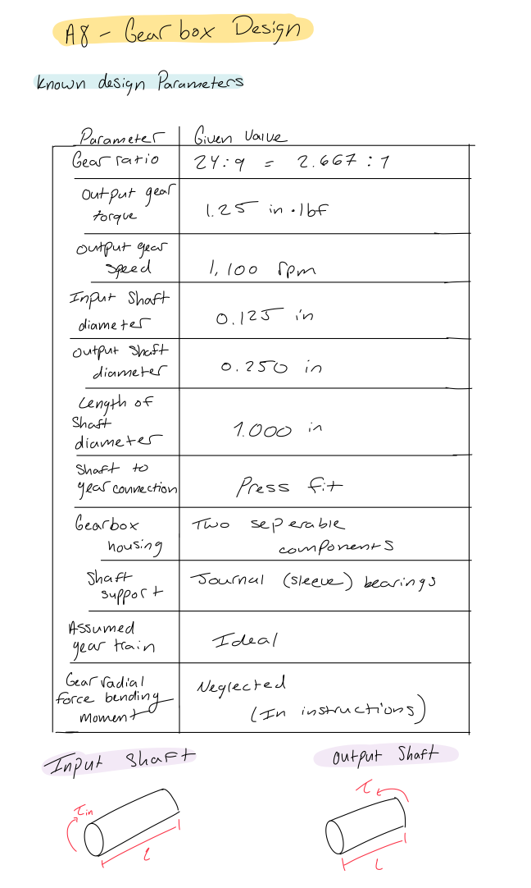
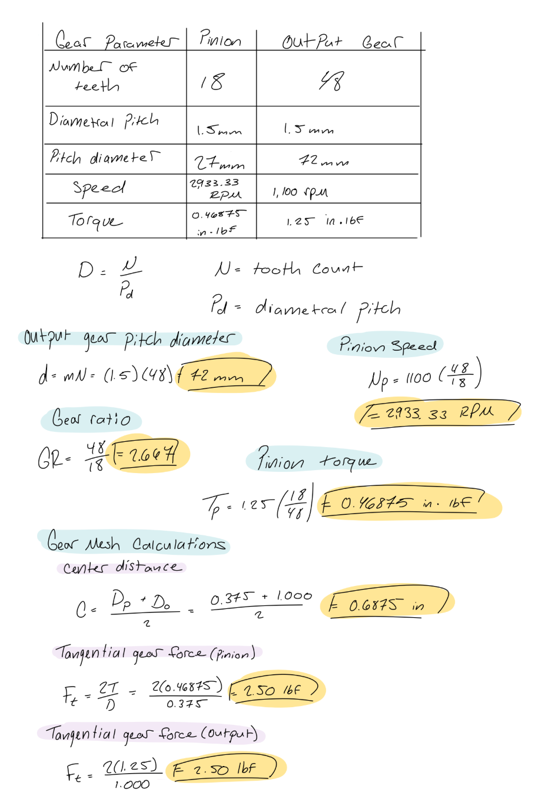
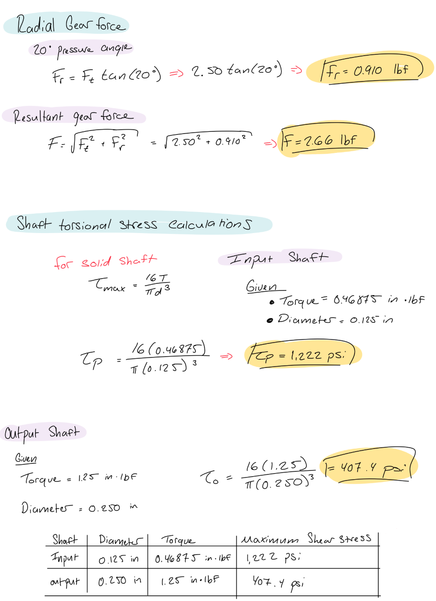
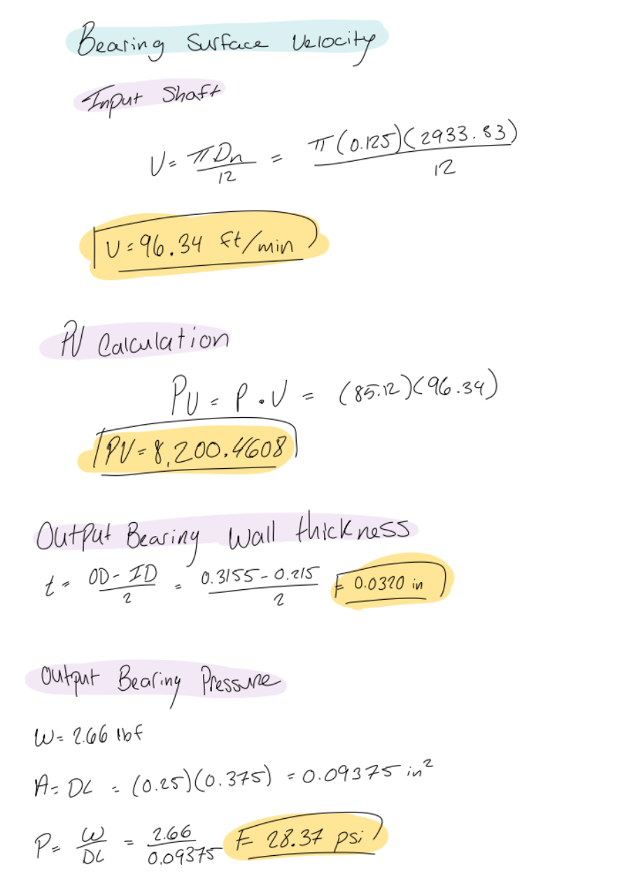
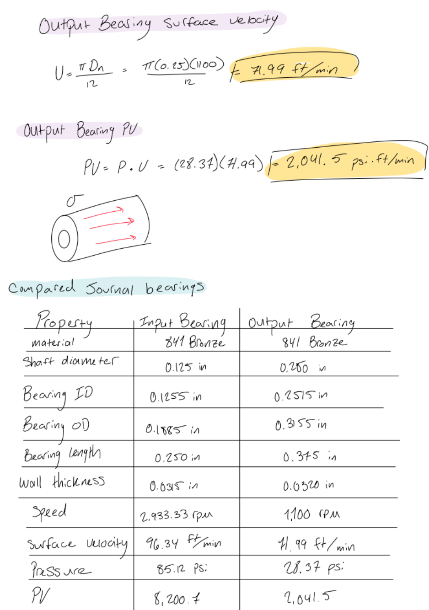
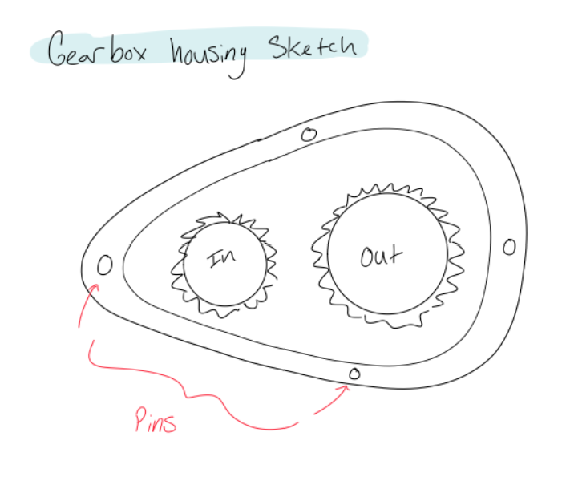
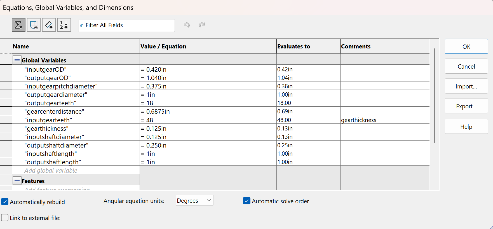
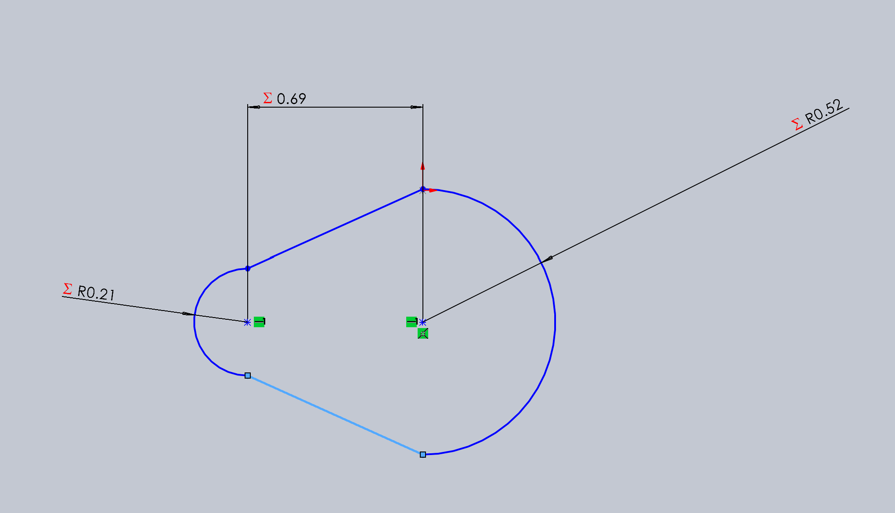
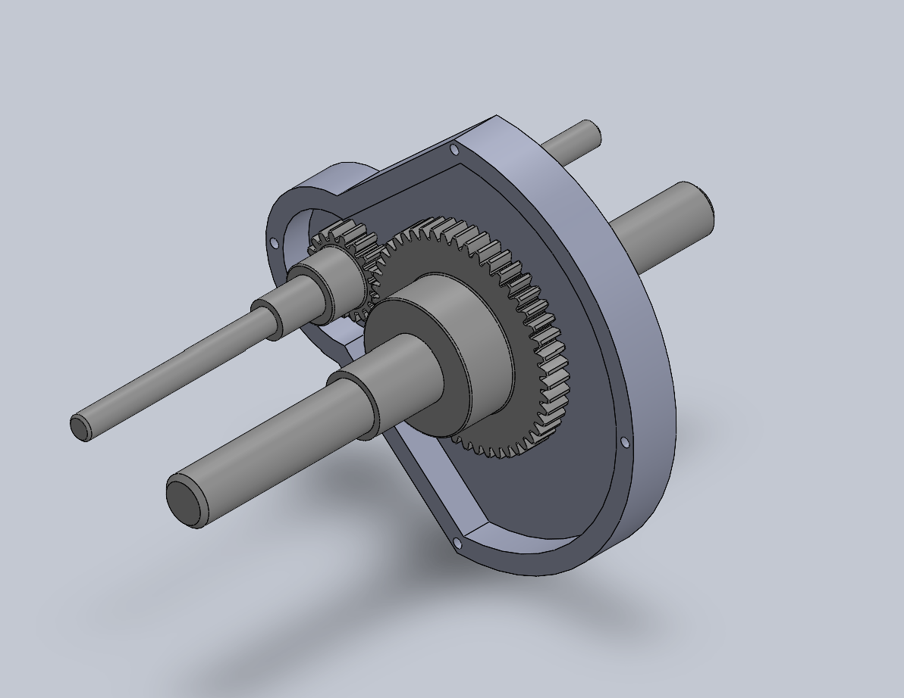
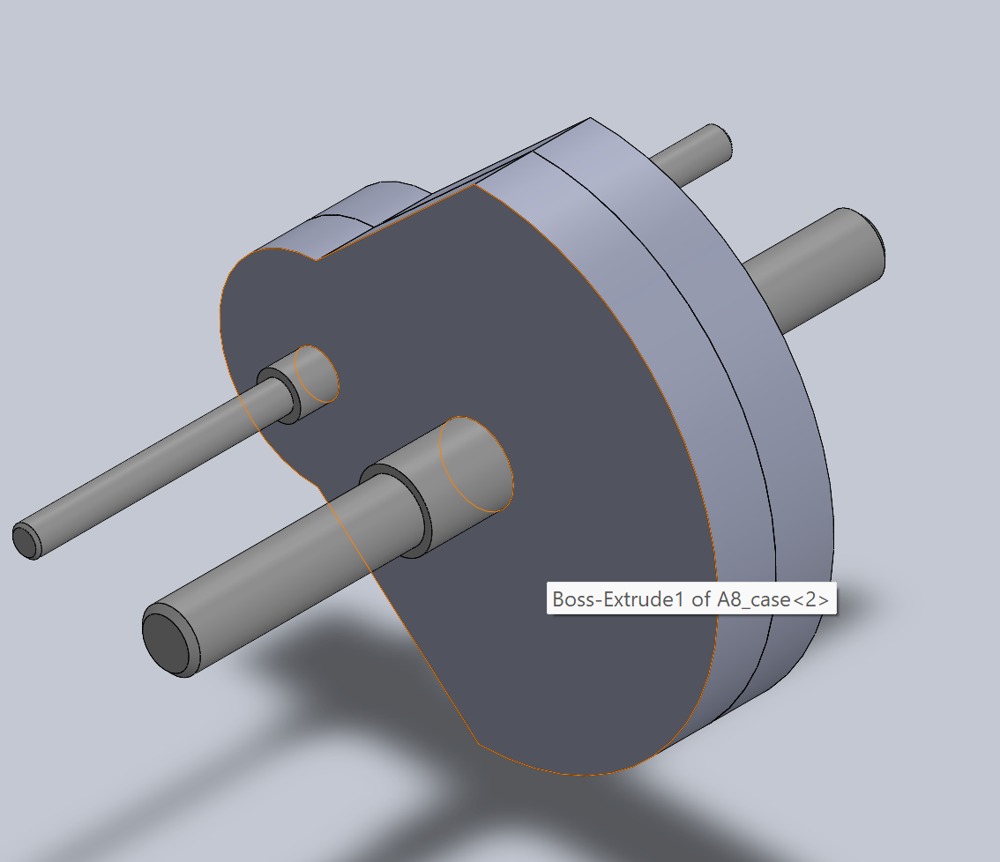

# A8 – Gears

## Objective

The objective of this project was to design a gearbox that can be assembled and disassembled while meeting the specified gear ratio, speed, and torque requirements. The design includes an input shaft, output shaft, two spur gears, journal bearings, and a two-piece gearbox housing.

The project required the selection and analysis of the gears, shafts, and journal bearings. The input and output shafts were evaluated for torsional strength, while the journal bearings were evaluated based on bearing pressure, surface velocity, PV rating, and wall thickness.

A parametric SolidWorks model was developed to create the gearbox components and verify that the gears, shafts, and bearings fit together. The final design also required engineering drawings following ASME Y14.5 standards.

### Design Requirements

| Parameter | Required Value |
|---|---:|
| Gear type | Spur gears |
| Gear ratio | 24:9 (48:18) |
| Gear pressure angle | 20° |
| Diametral pitch | 48 |
| Output speed | 1,100 rpm |
| Output torque | 1.25 in·lbf |
| Input shaft diameter | 0.125 in |
| Output shaft diameter | 0.250 in |
| Input shaft length | 1.000 in |
| Output shaft length | 1.000 in |
| Input gear teeth | 18 |
| Output gear teeth | 48 |
| Gearbox construction | Two-piece housing |
| Shaft fit | Running sliding fit in housing/bearings |
| Gear-to-shaft connection | Press fit through gear hubs |

## Analyze

### 2.1 Gear Selection and Specifications

The gearbox uses two brass spur gears from McMaster-Carr. Both gears have a 20° pressure angle and a diametral pitch of 48 teeth per inch. The input pinion has 18 teeth, while the output gear has 48 teeth.

The gear ratio is calculated using:

Gear Ratio = Number of Output Gear Teeth / Number of Input Pinion Teeth

Gear Ratio = 48 / 18 = 2.667

The resulting gear ratio is 2.667:1. This means the output gear rotates more slowly than the input pinion while increasing the available output torque.

The pitch diameters are:

Input pinion pitch diameter = 0.375 in

Output gear pitch diameter = 1.000 in

The distance between the gear centers is:

C = (D1 + D2) / 2

C = (0.375 + 1.000) / 2

C = 0.6875 in

### 2.2 Gear Speed and Torque Calculations

The output speed is specified as 1,100 rpm. Assuming an ideal gear train, the input speed is calculated using:

N1 / N2 = T2 / T1

N1 = 1,100(48 / 18)

N1 = 2,933.33 rpm

The input torque is calculated using conservation of power:

T1 × N1 = T2 × N2

T1 = (1.25 × 1,100) / 2,933.33

T1 = 0.46875 in·lbf

Therefore, the calculated operating conditions are:

- Input speed: 2,933.33 rpm
- Output speed: 1,100 rpm
- Input torque: 0.46875 in·lbf
- Output torque: 1.25 in·lbf

### 2.3 Gear Forces

The tangential force transmitted between the gears is calculated using:

Ft = 2T / D

Using the input pinion:

Ft = (2 × 0.46875) / 0.375

Ft = 2.50 lbf

The radial force is calculated using the pressure angle:

Fr = Ft × tan(20°)

Fr = 2.50 × tan(20°)

Fr = 0.910 lbf

These forces act at the gear mesh and are used when determining the reactions at the shaft supports.

### 2.4 Input Shaft Analysis

The input shaft has a specified diameter of 0.125 in and a length of 1.000 in. It transmits the calculated input torque of 0.46875 in·lbf.

For a solid circular shaft, the maximum torsional shear stress is:

τmax = 16T / (πd³)

Substituting the input shaft dimensions:

τmax = [16(0.46875)] / [π(0.125)³]

τmax = approximately 1,222 psi

The calculated shear stress must be compared with the allowable shear stress of the selected shaft material to determine whether the shaft diameter is sufficient.

### 2.5 Output Shaft Analysis

The output shaft has a specified diameter of 0.250 in and a length of 1.000 in. It transmits the specified output torque of 1.25 in·lbf.

Using the torsional shear stress equation:

τmax = 16T / (πd³)

Substituting the output shaft dimensions:

τmax = [16(1.25)] / [π(0.250)³]

τmax = approximately 407 psi

The calculated shear stress must be compared with the allowable shear stress of the selected shaft material.

### 2.6 Journal Bearing Selection

Two SAE 841 bearing bronze sleeve bearings were selected from McMaster-Carr.

The input bearing has the following specifications:

- Shaft diameter: 0.125 in
- Bearing inside diameter: 0.1255 in
- Bearing outside diameter: 0.1885 in
- Bearing length: 0.250 in

The output bearing has the following specifications:

- Shaft diameter: 0.250 in
- Bearing inside diameter: 0.2515 in
- Bearing outside diameter: 0.3155 in
- Bearing length: 0.375 in

Both bearings are oil-impregnated sleeve bearings designed for radial loading.

### 2.7 Journal Bearing Calculations

The projected bearing area is calculated using:

A = D × L

The bearing pressure is:

P = W / (D × L)

The shaft surface velocity is:

V = πDN / 12

where D is in inches and N is in rpm. The resulting velocity is in ft/min.

The pressure-velocity value is:

PV = P × V

The input bearing and output bearing must be evaluated separately using their respective shaft speeds, bearing dimensions, and calculated bearing reaction loads.

The bearing reaction load, W, must be obtained from the shaft free-body diagrams. It should not automatically be assumed to equal the entire gear force.

### 2.8 Journal Bearing Wall Thickness

The bearing wall thickness is calculated using:

t = (OD - ID) / 2

Input bearing:

t = (0.1885 - 0.1255) / 2

t = 0.0315 in

Output bearing:

t = (0.3155 - 0.2515) / 2

t = 0.0320 in

These values represent the radial wall thickness of each selected sleeve bearing.

### 2.9 Housing Design Considerations

The gearbox housing must support both shafts and maintain the correct gear center distance. The housing must also provide enough clearance for the gears to rotate without contacting the enclosure.

The housing was designed as two separate components to allow the gearbox to be assembled and disassembled. The bearing locations, shaft openings, gear cavity, and fastening locations must be considered during the design process.

## Decide

### 3.1 Gear Selection

The 18-tooth brass pinion and 48-tooth brass output gear were selected because they have matching 48 diametral pitch and 20° pressure angles. These specifications allow the gears to mesh correctly.

The gear combination provides the required 2.667:1 gear ratio.

### 3.2 Shaft Design

The input and output shaft diameters were initially specified by the assignment. Torsional stress calculations were performed to evaluate the strength of each shaft.

The calculated torsional shear stresses were approximately 1,222 psi for the input shaft and 407 psi for the output shaft. Final acceptance of the shaft diameters depends on comparing these stresses with the allowable stress of the selected shaft material and the required factor of safety.

### 3.3 Journal Bearing Selection

SAE 841 bearing bronze sleeve bearings were selected for both shafts. The bearings are oil-impregnated and provide a simple method of supporting rotating shafts under radial loads.

The input bearing was selected for the 1/8-inch shaft, and the output bearing was selected for the 1/4-inch shaft. Their different dimensions accommodate the different shaft diameters.

### 3.4 Housing Design

A two-piece housing was selected to allow the gearbox to be assembled and disassembled. The housing incorporates bearing locations, shaft openings, and clearance for the rotating gears.

The final housing dimensions were developed around the actual gear and bearing dimensions rather than using arbitrary component sizes.

### 3.5 Final Design Selection

The final design uses two brass spur gears, two shafts, two SAE 841 bronze sleeve bearings, and a two-piece housing. The design is intended to meet the specified speed and torque requirements while providing support and clearance for the rotating components.

## Communicate

### 4.1 Final SolidWorks Components

The gearbox was modeled in SolidWorks using parametric dimensions. The individual components were modeled using the dimensions obtained from the assignment requirements and McMaster-Carr product specifications.

The modeled components include:

1. Input shaft
2. Output shaft
3. Input pinion
4. Output gear
5. Input journal bearing
6. Output journal bearing
7. Upper gearbox housing
8. Lower gearbox housing

### 4.2 Gearbox Assembly

The individual components were assembled in SolidWorks to create the complete gearbox. The assembly was used to verify the relative positions of the gears, shafts, bearings, and housing.

The gear center distance was designed around the calculated value of 0.6875 in. The housing was designed to provide clearance around the gears and allow the gearbox to be disassembled.

### 4.3 Engineering Drawings

Engineering drawings were created for the required components and complete assembly.

The drawing package includes:

- Input shaft drawing
- Output shaft drawing
- Upper housing drawing
- Lower housing drawing
- Input plain bearing drawing
- Output plain bearing drawing
- Complete gearbox assembly drawing

The drawings follow the required third-angle projection layout and include dimensions and tolerances following ASME Y14.5 standards.

The specified tolerance block was included:

- X.X ± 0.02
- X.XX ± 0.01
- X.XXX ± 0.005

Additional geometric tolerancing was applied to critical features where appropriate.

### 4.4 Lessons Learned

Throughout this assignment, I learned how gear specifications affect the performance and compatibility of a gear train. I learned that matching diametral pitch and pressure angle is necessary for two spur gears to mesh correctly.

I also learned how torque, shaft diameter, and rotational speed affect the design of a power transmission system. The torsional stress calculations demonstrated how strongly shaft diameter influences the stress in a solid circular shaft.

The journal bearing calculations helped me understand the importance of bearing pressure, surface velocity, lubrication, and bearing material selection. I also learned that bearing loads must be determined from the shaft support reactions rather than simply assuming that each bearing carries the entire gear force.

During the SolidWorks modeling process, I gained experience using global variables and equations to control component dimensions. I also learned that designing parts individually is only one part of the process; the components must fit together correctly in the final assembly.

Finally, I learned the importance of engineering drawings, tolerances, and clear documentation when designing a mechanical system that must be manufactured and assembled.

The time I spent on this assignment was six hours

### 4.5 CAD Files and Final Deliverables

The final SolidWorks part files, assembly file, and engineering drawings are included with the project documentation.

[Gear Box Assembly](A8_gearBoxAssem.zip)
