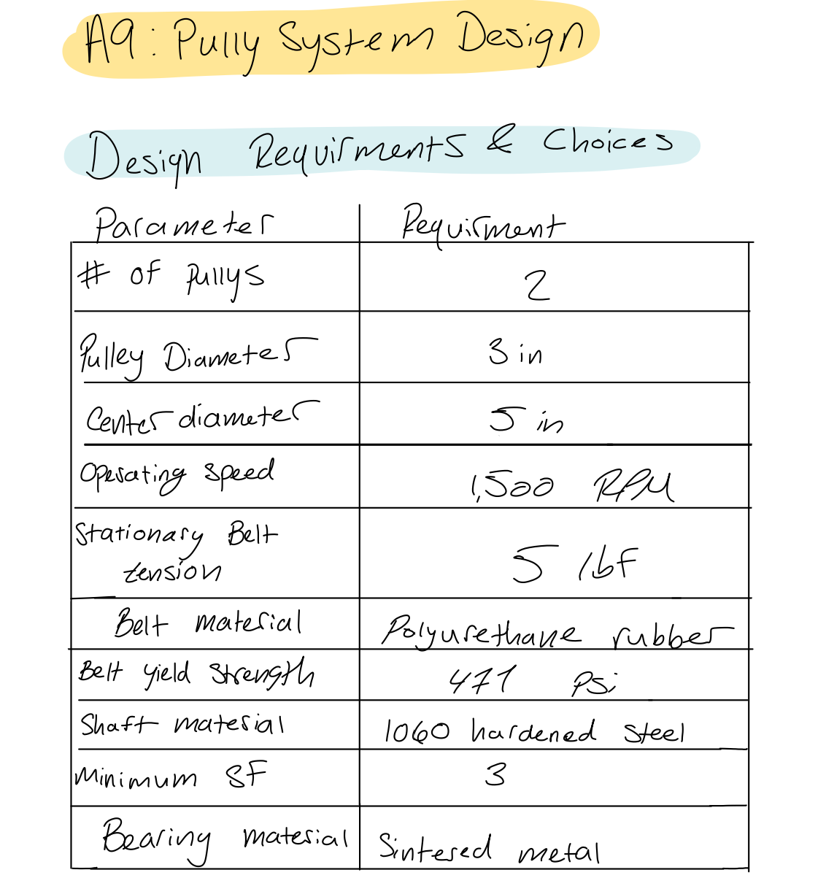
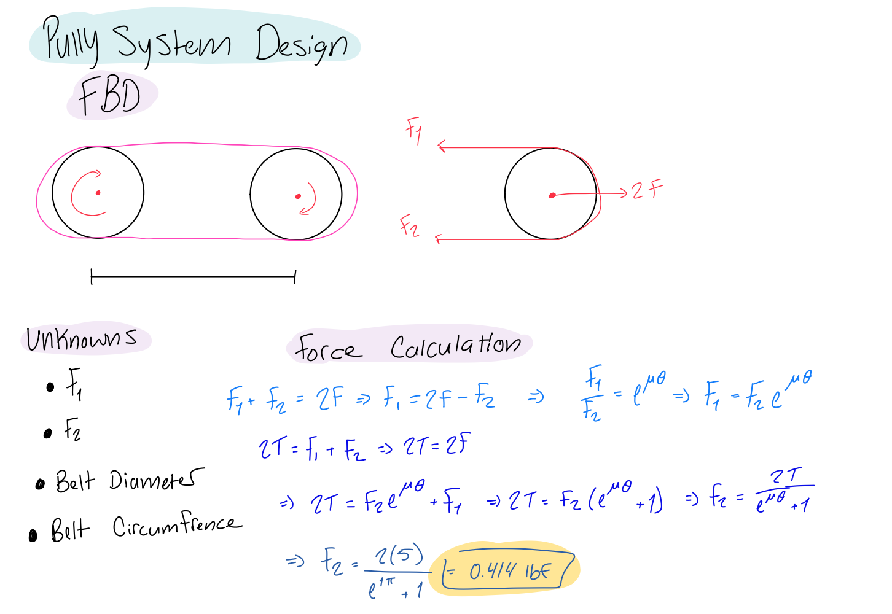
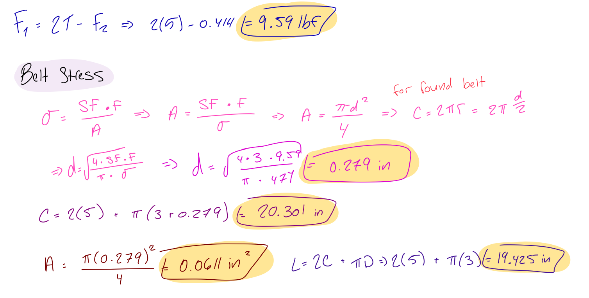
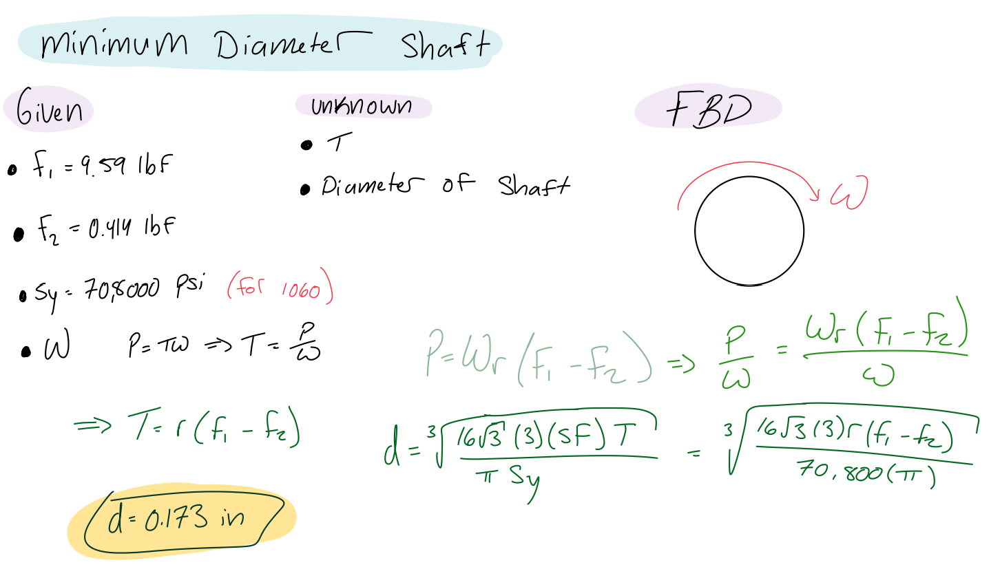
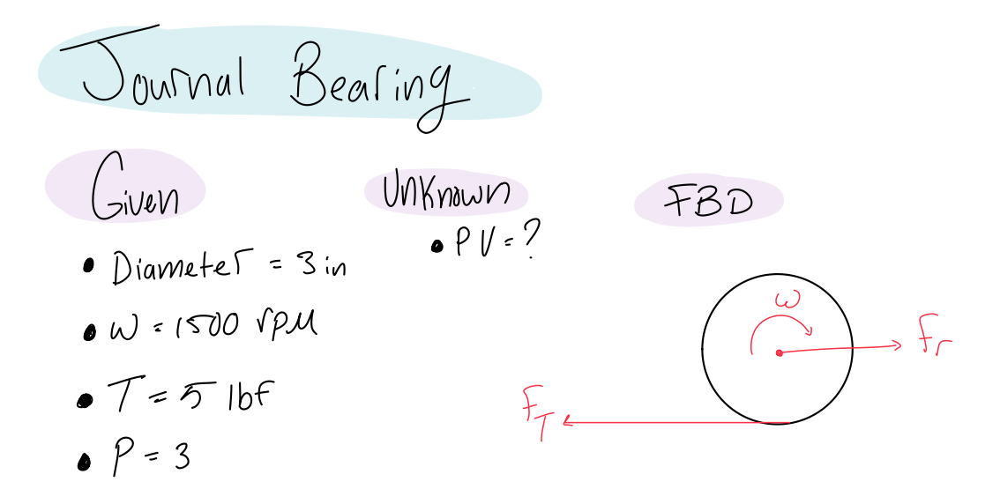
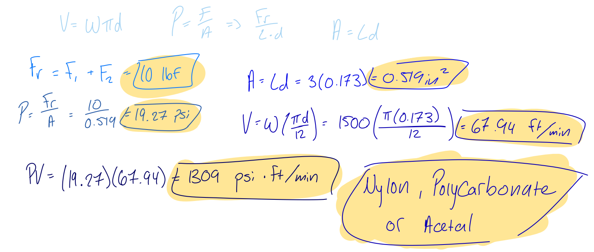
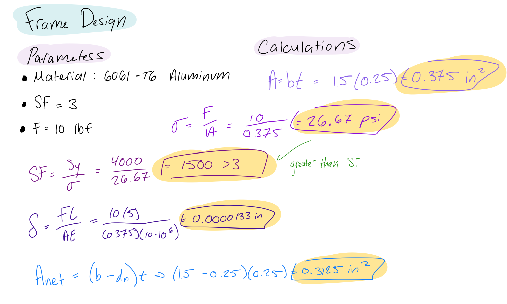
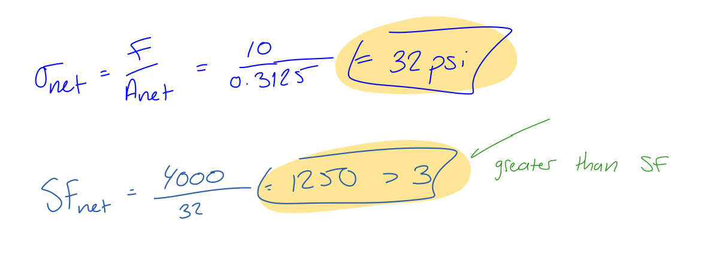
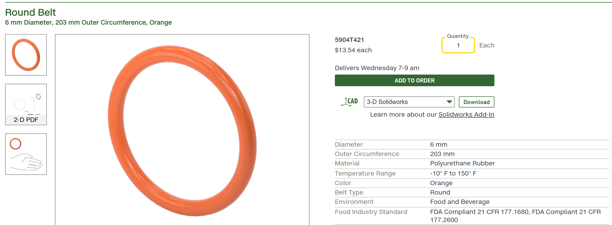

# A9 – Pulleys

## Objective

The objective of this project was to design a pulley system capable of transferring power between two parallel shafts separated by a center distance of 4–6 inches. The design required two 3-inch-diameter pulleys connected by a polyurethane rubber belt, operating at a selected speed between 1,000 and 2,000 RPM.

To complete the design, I needed to determine the appropriate belt size and length, calculate the minimum required shaft diameter using hardened 1060 steel, and select suitable journal bearings based on their pressure, surface velocity, and PV rating. I also needed to design a supporting frame capable of holding the pulley system while maintaining a minimum factor of safety of 3.

Throughout this project, I applied engineering principles involving force analysis, torque, stress, material selection, and deflection to develop a pulley system that met the assignment requirements.

### Design Requirements and Initial Choices

I began the pulley system design by identifying the requirements provided in the assignment and selecting values that fell within the allowed design ranges. I chose a pulley diameter of 3 inches, a center distance of 5 inches, and an operating speed of 1,500 RPM. I also selected a stationary belt tension of 5 lbf and a minimum required safety factor of 3.

For the materials, I selected polyurethane rubber for the belt, hardened 1060 steel for the shafts, sintered metal as the initial journal bearing material selection, and 6061-T6 aluminum for the supporting frame. These choices established the starting parameters for the belt, shaft, bearing, and frame calculations.
## Analyze

## Analyze

### Belt Design

I started the design process by focusing on determining the forces acting on the belt and calculating the required belt dimensions. I began by listing the known and unknown variables and creating a free-body diagram (FBD) to represent the forces acting on the pulley system.

Using the selected stationary belt tension of 5 lbf and the belt friction relationship, I calculated the tight-side and loose-side belt forces. These calculations resulted in a tight-side force of 9.59 lbf and a loose-side force of 0.414 lbf.

After determining the belt forces, I calculated the required belt cross-sectional area and diameter using the given polyurethane rubber yield strength of 471 psi and a minimum factor of safety of 3. The calculated cross-sectional area was approximately 0.0611 in², resulting in a theoretical belt diameter of 0.279 inches.

Next, I calculated the theoretical length required for an open belt connecting two 3-inch-diameter pulleys separated by 5 inches. Using the open-belt length equation, I determined that the required belt length was approximately 19.425 inches.

To identify a commercially available belt, I researched McMaster-Carr and found a polyurethane rubber round belt, part number 5904T421. According to the product specifications, this belt has a 6 mm diameter, a 203 mm outer circumference, and is made of polyurethane rubber. It is orange and is rated for temperatures between -10°F and 150°F.

The catalog selection provided a potential material and belt type for the design. However, comparing its dimensions with my calculations showed that the selected belt would require further evaluation because its circumference and diameter are smaller than the theoretical requirements.

### Minimum Shaft Diameter

After completing the belt calculations, I moved on to determining the minimum required shaft diameter. I used the tight-side and loose-side belt forces calculated previously to determine the torque transmitted through the pulley shaft.

I first identified the known values, including the belt forces, pulley radius, and yield strength of hardened 1060 steel. I then created a free-body diagram to represent the loading conditions and direction of rotation.

Using the difference between the tight-side and loose-side belt forces and the pulley radius, I calculated the torque transmitted through the shaft. I then applied the torsional stress relationship while accounting for the required factor of safety.

The calculated minimum shaft diameter was approximately 0.173 inches. This represents the theoretical minimum diameter based on the loading conditions and material properties used in my calculations.

### Journal Bearing Design

Once I determined the minimum shaft diameter, I began evaluating the journal bearing requirements. I used the shaft diameter, operating speed, and belt forces to calculate the bearing loading conditions.

I first determined the radial force acting on the pulley shaft by adding the tight-side and loose-side belt forces. This resulted in a radial force of 10 lbf. I then used the shaft diameter and an assumed bearing length of 3 inches to calculate the projected bearing area.

Using the radial force and projected area, I calculated an average bearing pressure of approximately 19.27 psi. Next, I calculated the shaft's surface velocity using the shaft diameter and operating speed of 1,500 RPM. The resulting surface velocity was approximately 67.94 ft/min.

Finally, I multiplied the bearing pressure by the surface velocity to obtain a PV value of approximately 1,309 psi·ft/min. This value can be used to evaluate suitable journal bearing materials. Based on my initial material investigation, I considered nylon, polycarbonate, and acetal as potential nonmetallic bearing options.

### Frame Design and Engineering Analysis

After completing the pulley, shaft, and bearing calculations, I moved on to designing a frame to support the pulley system. I selected 6061-T6 aluminum because it provides sufficient strength for the loading conditions while keeping the structure relatively lightweight.

I used a design load of 10 lbf and a minimum required factor of safety of 3 to evaluate the frame. I calculated the cross-sectional area and used the applied load to determine the resulting stress. I also considered the effect of the mounting holes by calculating the net cross-sectional area.

The calculated stress for the original cross-section was approximately 26.67 psi, resulting in a factor of safety of approximately 1,500. After accounting for the mounting holes, the net stress increased to approximately 32 psi, giving a factor of safety of approximately 1,250. Both calculated safety factors exceeded the required minimum of 3.

I also calculated the estimated frame deflection under the applied load. The resulting deflection was approximately 0.0000133 inches. Based on these simplified calculations, the proposed frame cross-section provided sufficient strength and stiffness for the loading conditions considered.

## Decide 

After completing the engineering calculations, I compared my theoretical design requirements with commercially available components to determine which materials and components would be appropriate for the pulley system.

For the belt, I researched McMaster-Carr and identified part number 5904T421, a polyurethane rubber round belt. I considered this option because it uses the required belt material and has a 6 mm diameter. Its polyurethane construction also makes it a potential option for the application.

However, after comparing the catalog specifications with my calculated requirements, I determined that the belt dimensions would need to be verified before finalizing the selection. The catalog lists an outer circumference of 203 mm, while my calculations indicate that approximately 493.4 mm is required. The catalog diameter of 6 mm is also smaller than my calculated diameter of approximately 7.09 mm.

For the shafts, I retained hardened 1060 steel because it provided the material properties needed to calculate the minimum shaft diameter while satisfying the required safety factor. My calculations indicated a theoretical minimum diameter of approximately 0.173 inches.

For the journal bearings, I considered nylon, polycarbonate, and acetal based on the calculated bearing pressure of 19.27 psi and PV value of approximately 1,309 psi·ft/min. The final bearing selection would need to satisfy the manufacturer's pressure, velocity, and PV limitations.

For the supporting frame, I selected 6061-T6 aluminum because of its strength-to-weight characteristics. My calculations showed that the frame exceeded the minimum required factor of safety of 3, even after accounting for the reduction in cross-sectional area caused by the mounting holes.

Overall, I used the engineering calculations and manufacturer specifications to narrow down the component selections. The remaining consideration was ensuring that the commercially available belt dimensions matched the theoretical belt requirements before finalizing the complete assembly.

## Communicate

### Conclusion and Lessons Learned

Throughout this project, I learned how to apply engineering principles to the design of a complete pulley system. I used concepts involving friction, torque, torsional stress, bearing pressure, surface velocity, and frame deflection to evaluate the different components and determine the requirements for a functional design.

One of the most important things I learned was how the different components of a mechanical system depend on one another. The tight-side and loose-side belt forces determine the torque transmitted through the pulley, while their combined loading contributes to the radial force acting on the shaft and journal bearings. This showed me why each component must be analyzed as part of the overall system rather than independently.

I also gained experience researching commercially available components using the McMaster-Carr catalog. By comparing my calculated belt requirements with the specifications of part number 5904T421, I learned the importance of checking manufacturer dimensions against theoretical calculations before selecting a component. A product may have the correct material and general design but still not meet the dimensional requirements of the system.

Another important lesson was understanding how mounting holes affect the strength of a structural component. Removing material reduces the net cross-sectional area, which increases the resulting stress. Accounting for these changes allowed me to evaluate the frame more accurately.

Overall, this project helped me improve my ability to move from theoretical engineering calculations to actual component research and mechanical design decisions. It also reinforced the importance of verifying component specifications, considering safety factors, and evaluating how individual design choices affect the performance of an entire mechanical system.

Time Spent: I spent approximately 2.5 hours (2 hours and 30 minutes) completing the calculations, researching components, and developing the engineering analysis for this pulley system project. hours and 30 minutes) completing the calculations and design analysis for this pulley system project.
