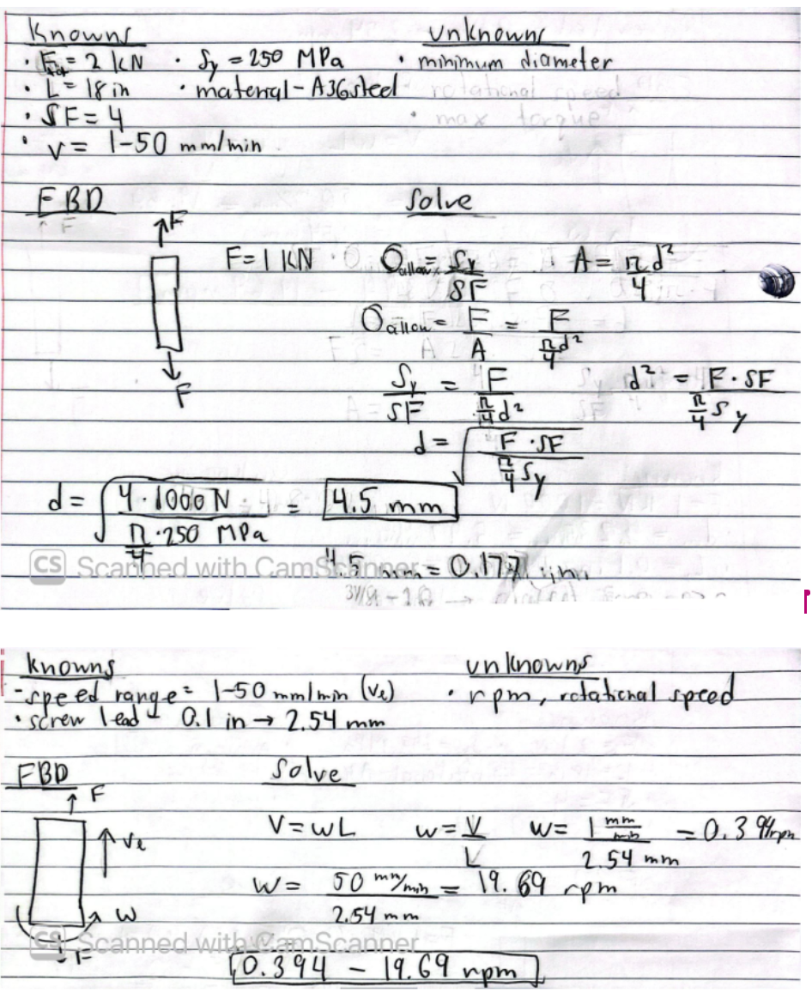

# A10 – Lead Screw Translating System

## Objective

This assignment was a group assignment that consisted of coordinating with teammates in order to design a project with set constraints. A tensile tester is a mechanism that, through uniaxial tension, allows engineers to test materials and gather information about it's properties such as yield strength, ultimate yield strength, and elongation at break. This information can be used for deciding material usage in different applications. The objective of this assignment was to design a tensile tester that could handle a 2kN axial load and a crosshead speed from 1-50 mm/min. As a team we developed a lead screw and ensure that our tensile tester would be accurate and could repeatedly apply a 2 kN load.

## Analyze

### Diameter- Farima Pournia
For deciding on what lead screw to select the diameter was first calculated. This was done by using the guidelines given like yield strength, force, and safety factor. The safety factor equation was used to be set equal to the stress equation which used the area of a circle for it's area equation. The parameters were then plugged into this equation and the diameter was solved for.

Figure 1 – Lead screw diameter calculations – Farima Pournia

To select a diameter for the lead screw the closest diameter to the one calculated is 5.97 mm which corelates with a 3/8-10 screw.
Rotational Speed- Farima Pournia
The rotational speed of the lead screw was then calculated through the speed range given and the screw lead that was found through the diameter that was calculated. Using the equation for linear speed rotational speed was solved for. This equation was then used to plug in the lower and upper bounds of the linear speed range and a range for rotational speed was calculated.

Figure 2 – Rotational speed calculations – Farima Pournia

Torque- Farima Pournia
The next parameter that was calculated was torque by using the equation for a square threaded lead screw. The diameter of the actual screw selected was used and not the diameter that was calculated. The screw lead was found through the diameter of the screw selected and the coefficient of friction was found in the Machinery Handbook under the value for friction of steel against bronze. These values were plugged into the torque equation and solved.

Figure 3 – Torque calculations – Farima Pournia

## Decide
_Reference your concept selection (Pugh matrix) here. How does this design follow from that decision?_

## Communicate

