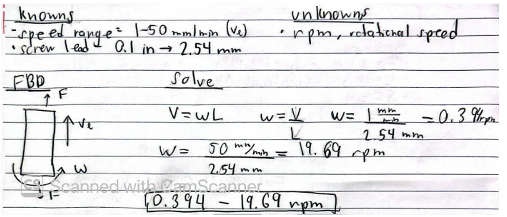
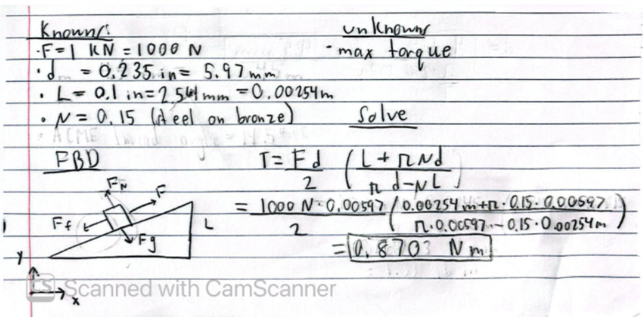
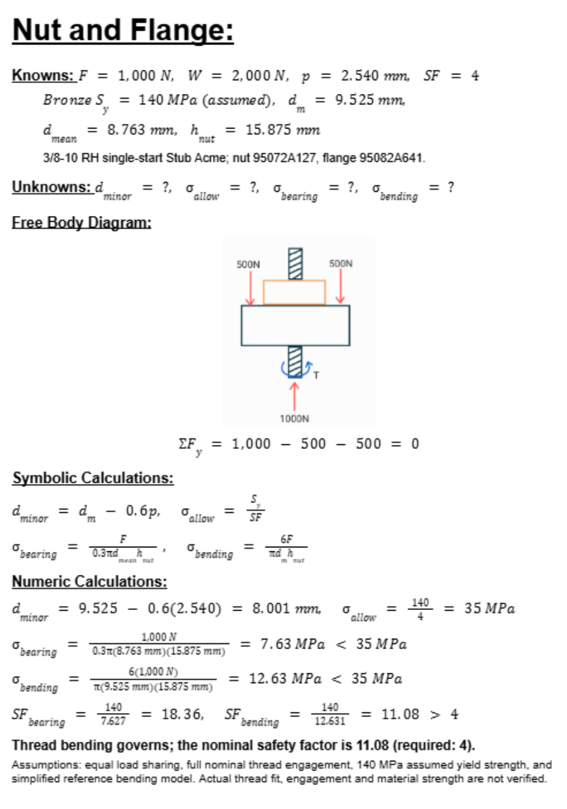
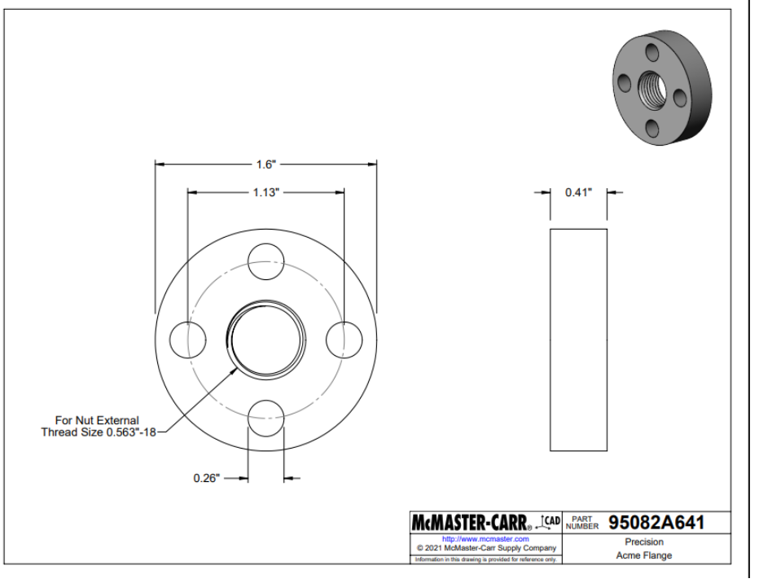
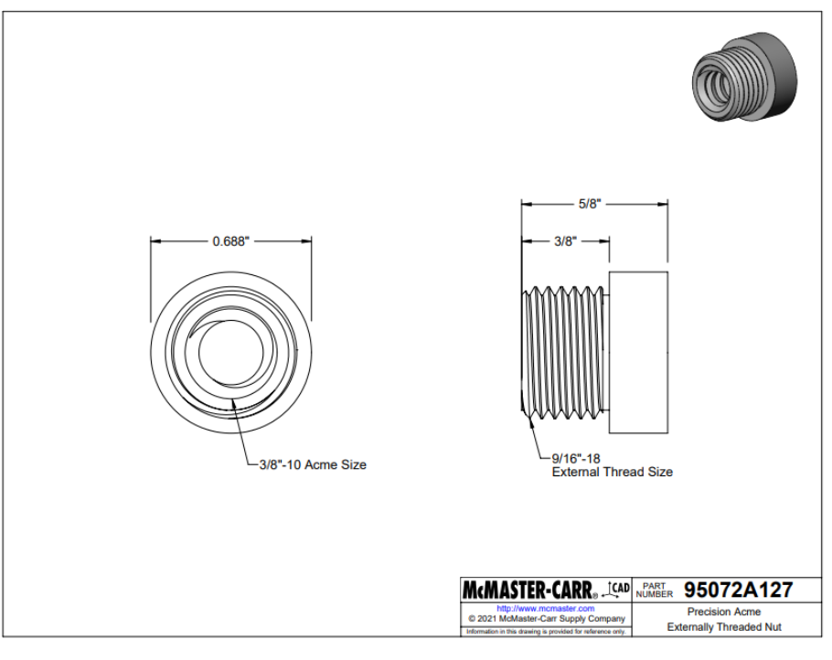

# A10 – Lead Screw Translating System

## Objective

This assignment was a group assignment that consisted of coordinating with teammates in order to design a project with set constraints. A tensile tester is a mechanism that, through uniaxial tension, allows engineers to test materials and gather information about it's properties such as yield strength, ultimate yield strength, and elongation at break. This information can be used for deciding material usage in different applications. The objective of this assignment was to design a tensile tester that could handle a 2kN axial load and a crosshead speed from 1-50 mm/min. As a team we developed a lead screw and ensure that our tensile tester would be accurate and could repeatedly apply a 2 kN load.

## Analyze

### Diameter- Farima Pournia
For deciding on what lead screw to select the diameter was first calculated. This was done by using the guidelines given like yield strength, force, and safety factor. The safety factor equation was used to be set equal to the stress equation which used the area of a circle for it's area equation. The parameters were then plugged into this equation and the diameter was solved for.

Figure 1 – Lead screw diameter calculations – Farima Pournia

To select a diameter for the lead screw the closest diameter to the one calculated is 5.97 mm which corelates with a 3/8-10 screw.
Rotational Speed- Farima Pournia
The rotational speed of the lead screw was then calculated through the speed range given and the screw lead that was found through the diameter that was calculated. Using the equation for linear speed rotational speed was solved for. This equation was then used to plug in the lower and upper bounds of the linear speed range and a range for rotational speed was calculated.

Figure 2 – Rotational speed calculations – Farima Pournia

Torque- Farima Pournia
The next parameter that was calculated was torque by using the equation for a square threaded lead screw. The diameter of the actual screw selected was used and not the diameter that was calculated. The screw lead was found through the diameter of the screw selected and the coefficient of friction was found in the Machinery Handbook under the value for friction of steel against bronze. These values were plugged into the torque equation and solved.

Figure 3 – Torque calculations – Farima Pournia

From calculating these parameters a lead screw was chosen from McMaster Carr. The closest diameter of lead screw that fit the diameter that was solved for was 5.97 mm, so a 3/8-10 steel acme lead screw was selected. For this assignment our lead screw is required to be at least 18 inches. The lead screw sizing selected only had 3 feet, 6 feet or 12 inches. So to accommodate for this we selected the 3 foot long lead screw and would cut it down closer to size. The lead screw we selected is linked below.

[McMaster-Carr Part 93410A608](https://www.mcmaster.com/93410A608/)

### Nut and Flange Design – A.C. Florencondia

The nut and flange assembly transfers the axial load from the two lead screws to the crosshead. Under the assumed symmetric loading condition, each assembly supports 1,000 N of the total 2,000 N tensile load. A minimum factor of safety of 4 was used for the internal thread stress analysis.

I selected the 673 bronze externally threaded nut (McMaster-Carr 95072A127) and a separate 1215 carbon steel mounting flange (95082A641) to match the nominal 3/8-10 right-hand, single-start Stub Acme geometry of the selected lead screw. The nut has a 9/16-18 external mounting thread, which mates with the flange. A compatible one-piece bronze flanged nut was not found in the catalog during the selection process.

Internal Thread Stress Analysis
The calculation sheet includes the knowns and unknowns, the free-body diagram, symbolic equations, and numerical solutions. Each assembly is modeled with a 1,000 N axial load and two equivalent 500 N forces acting on the flange. These are idealized resultant forces, not individual bolt loads.

Figure 4 – Nut and flange calculations and free-body diagram

Parameter	Calculated or selected value
Total tensile load	2,000 N
Axial load per nut	1,000 N
Thread pitch	2.540 mm
Nominal nut length	15.875 mm
Assumed bronze yield strength	140 MPa
Required safety factor	4
Allowable stress	35.00 MPa
Nominal thread bearing stress	7.63 MPa
Nominal thread bending stress	12.63 MPa
Nominal bearing safety factor	18.36
Nominal bending safety factor	11.08

Thread bending governs the simplified internal-thread check. The nominal factor of safety of 11.08 exceeds the required value of 4 under the assumptions of equal load sharing, uniform loading over the full nominal engagement length, and an assumed bronze yield strength of 140 MPa. This is a preliminary calculation, not a certified load rating. Actual material strength, effective thread engagement, thread fit between the selected screw and nut, and the mounting connection must be verified before fabrication.

Selected Nut and Flange

Figure 5 – McMaster-Carr dimensioned drawing of the selected bronze nut (95072A127)

Figure 6 – McMaster-Carr dimensioned drawing of the selected steel flange (95082A641)

| **Component** | **Part number** | **Quantity** | **Key dimensions** |
| ------------- | -------------- | -----------: | ----------------- |
| McMaster-Carr Component | [93410A608](https://www.mcmaster.com/93410A608/ "93410A608") | 1 | See manufacturer drawing for dimensions |

### Crosshead Design and CAD - Rebekah Smith
The objective of this portion of the project was to design a crosshead for a mechanically driven tensile testing machine capable of applying a maximum tensile load of 2 kN. The crosshead connects the two vertical leadscrews through bronze nut and flange assemblies and provides a mounting location for the tensile specimen. The design required selecting an appropriate material and cross-sectional dimensions while maintaining a factor of safety of 4 and limiting the maximum crosshead deflection to 0.1 mm. Beam strength and deflection analyses were performed to determine whether the proposed crosshead dimensions would meet the design requirements.

Crosshead Design – Beam Strength Analysis
The crosshead was modeled as a simply supported beam with a concentrated load applied at its center. The two bronze nut and flange assemblies act as the supports for the crosshead. The two support reactions represent the forces from the left and right bronze nut and flange assemblies. Because the loading is symmetrical, both support reactions are equal.

## Decide
_Reference your concept selection (Pugh matrix) here. How does this design follow from that decision?_

## Communicate

