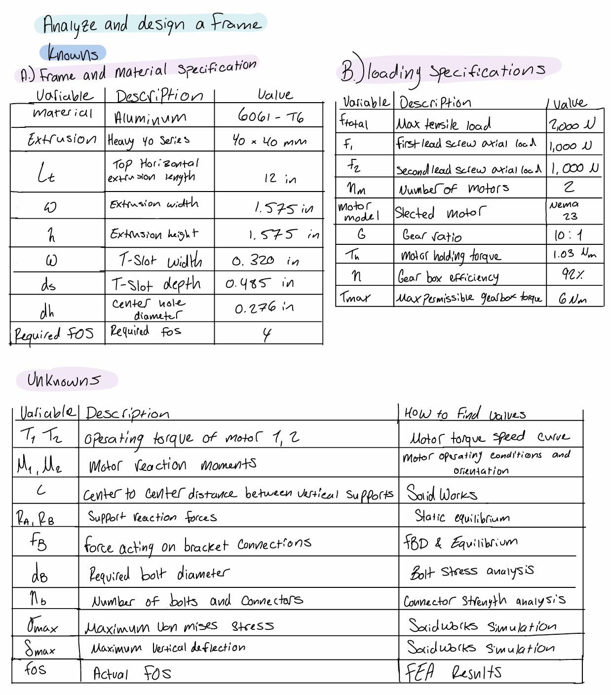

# A11 – Motor Selection

## Objective

The objective of this project is to design and develop a functional tensile testing machine capable of applying a maximum tensile load of 2 kN to evaluate the mechanical properties of materials. The design incorporates a lead screw drive system, stepper motors, a structural frame, a movable crosshead, and appropriate mounting components to safely and effectively apply the required load. The project involves selecting and sizing mechanical components, performing engineering calculations and free-body diagrams, evaluating structural integrity through finite element analysis (FEA), and creating a complete SolidWorks assembly. Each team member is responsible for specific portions of the design while collaborating on the final assembly, bill of materials, engineering costs, and project documentation. The final goal is to produce a complete, well-documented design that meets the project requirements while demonstrating the application of mechanical engineering principles.

## Analyze

### Frame Connections, Bracket Design, and Top Frame FEA - Bekah 

Design Responsibilities: Structural frame connections, motor twisting analysis, mounting bracket design, and top frame structural verification.
Design Objective
The objective of this portion of the project is to design and analyze the structural connections between the vertical supports and the top frame of the tensile tester. The frame must support the applied tensile loads while maintaining sufficient strength and stiffness to prevent excessive bending, twisting, or deformation during operation.
The analysis focuses on the forces and moments transferred from the two motors into the frame, the structural integrity of the mounting brackets and fasteners, and the ability of the top frame to withstand the applied loading conditions. Hand calculations and free-body diagrams are used to determine the forces and moments acting on the connections. SolidWorks Simulation is then used to evaluate the top frame through finite element analysis (FEA), including von Mises stress, displacement, factor of safety, and mesh convergence.

### Known and Unknown Variables

The following known variables were identified before beginning the frame connection and structural analysis, and the variables that must be determined through engineering calculations or SolidWorks Simulation.

### Frame Connection and Motor Twisting Analysis
\
The tensile tester uses two identical stepper motors positioned above the lead screw system. Both motors are mounted with their shafts oriented vertically downward. The center-to-center spacing between the motor and vertical support locations is 9.62 inches.
Each motor drives a lead screw that contributes to the movement of the crosshead. The two lead screws share the required tensile load, resulting in an axial load path of 1,000 N per lead screw under the 2,000 N maximum loading condition.
In addition to the axial loading, the motor mounting arrangement introduces reaction torques into the frame. These reaction torques must be considered because they can cause twisting or warping of the top extrusion and place additional loading on the mounting brackets.

### Motor Specifications

The selected motor is the STEPPERONLINE 23HS22-2804S-HG10 NEMA 23 stepper motor with a 10:1 planetary gearbox.
**Motor Specifications**

| Motor Specification | Value | Units |
|---|---:|---|
| Motor holding torque | 1.03 | N·m |
| Gearbox ratio | 10:1 | - |
| Gearbox efficiency | 92 | % |
| Theoretical gearbox output torque | 9.476 | N·m |
| Maximum permissible gearbox output torque | 6 | N·m |
| Motor phase current | 2.8 | A |
| Motor phase resistance | 0.9 | Ω |
| Gearbox backlash | ≤30 | Arcmin |

The theoretical gearbox output torque is calculated using:

$$
T_{out}=T_{motor}\times G\times\eta
$$

Substituting the motor specifications:

$$
T_{out}=1.03(10)(0.92)
$$

$$
\boxed{T_{out}=9.476\text{ N}\cdot\text{m}}
$$

However, the gearbox has a maximum permissible output torque of 6 N·m. Therefore, the actual output torque must not exceed this gearbox rating.

Important: The 1.03 N·m motor value is holding torque, not confirmed running torque. The actual operating torque depends on motor speed and the torque-speed curve. The final FEA moment must be based on the verified operating or design reaction torque, rather than automatically assuming the holding torque is available during operation.

Equilibrium Equations
The reaction forces and moments are determined using static equilibrium.
Sum of forces in the horizontal direction:
[
\sum F_x=0
]
Sum of forces in the vertical direction:
[
\sum F_y=0
]
Sum of forces in the remaining direction:
[
\sum F_z=0
]
Sum of moments about the x-axis:
[
\sum M_x=0
]
Sum of moments about the y-axis:
[
\sum M_y=0
]
Sum of moments about the z-axis:
[
\sum M_z=0
]
The equations are applied to the individual motor connections, vertical supports, and top frame to determine the reaction forces and moments at each connection.
Mounting Bracket Design and Analysis
The mounting brackets connect the vertical supports to the 40 Series T-slot frame. These connections must resist the forces and moments transferred from the motor and lead screw system while maintaining proper alignment of the tensile tester.
The selected bracket is the McMaster-Carr 5537T348 90-degree extended corner bracket. The bracket is manufactured from powder-coated 6063-T5 aluminum and includes M8 mounting hardware.

## Decide
_Reference your concept selection (Pugh matrix) here. How does this design follow from that decision?_

## Communicate
