# A11 – Motor Selection

## Objective

The objective of this project is to design and develop a functional tensile testing machine capable of applying a maximum tensile load of 2 kN to evaluate the mechanical properties of materials. The design incorporates a lead screw drive system, stepper motors, a structural frame, a movable crosshead, and appropriate mounting components to safely and effectively apply the required load. The project involves selecting and sizing mechanical components, performing engineering calculations and free-body diagrams, evaluating structural integrity through finite element analysis (FEA), and creating a complete SolidWorks assembly. Each team member is responsible for specific portions of the design while collaborating on the final assembly, bill of materials, engineering costs, and project documentation. The final goal is to produce a complete, well-documented design that meets the project requirements while demonstrating the application of mechanical engineering principles.

## Analyze

### Ac 
Design basis: 2,000 N total axial loading; two 3/8-10 right-hand single-start Stub Acme lead screws; 1,000 N per screw; 1–50 mm/min crosshead travel; required safety factor 4.
### Motor Selection (10 points)
Selected candidate: STEPPERONLINE 23HS22-2804S-HG10, NEMA 23 stepper with a 10:1 planetary gearbox. Two identical motors are proposed (one per lead screw).

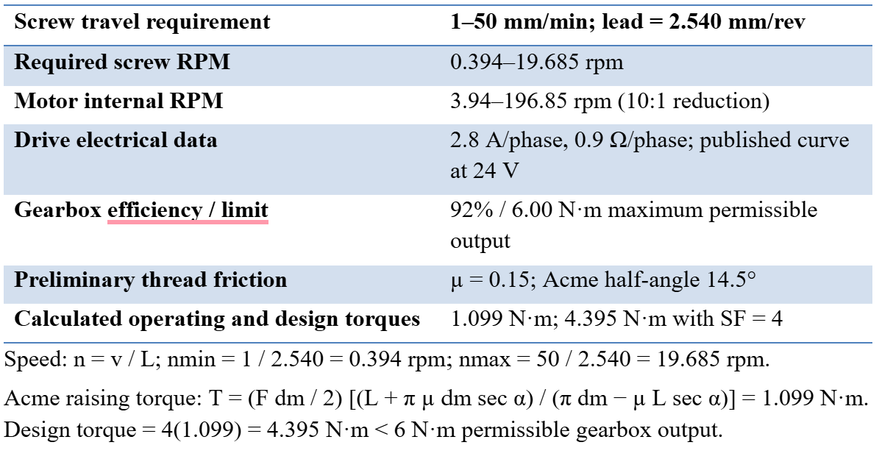
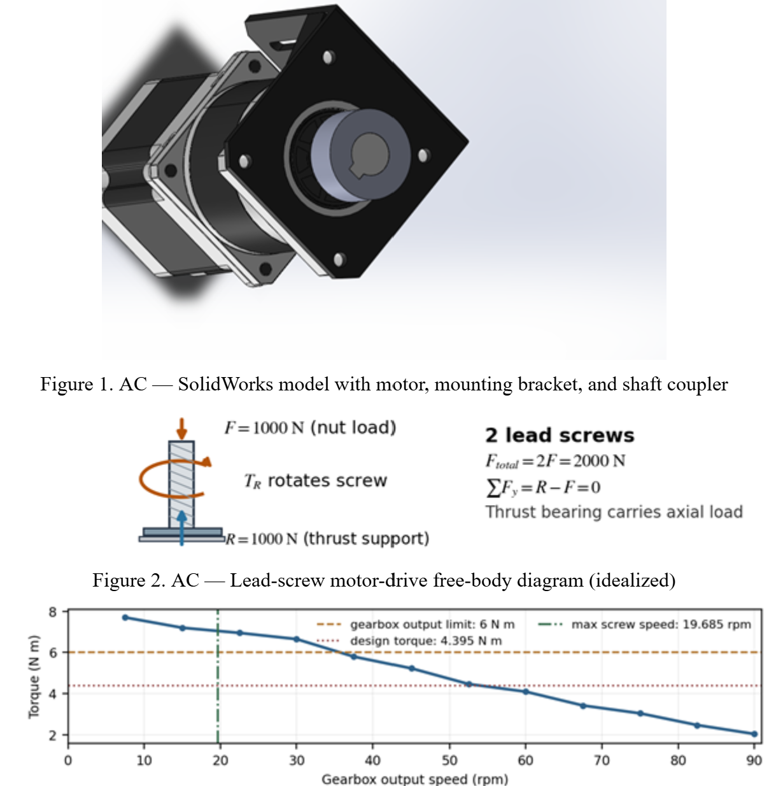

Verification note: The 6 N·m specification is a gearbox ceiling, not a continuous-duty certification. Manufacturer pull-out curve does not cover 0.394–7.5 rpm, and thrust-bearing friction is not included in the assumed raising torque. Motor control and power supply are outside the assigned mechanical design scope.
Manufacturer source: https://www.omc-stepperonline.com/nema-23-stepper-motor-l-56mm-gear-ratio-10-1-high-precision-planetary-gearbox-23hs22-2804s-hg10

### Motor Mount Design (10 points)
The bracket is modeled in SolidWorks as a gusset-reinforced L-shaped mounting component. The final conceptual layout positions the vertical mounting leg alongside the upper T-slot rail, keeping the motor concentric with the lead screw. The two elongated frame slots were modified to 5.5 mm clearance width.

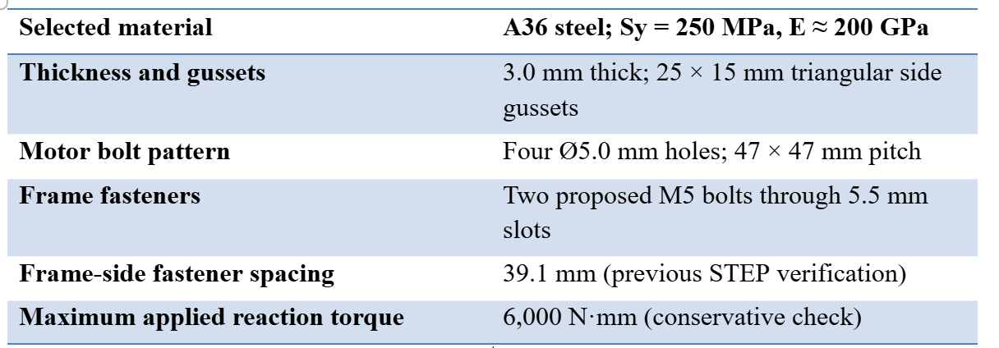

For four equally loaded motor bolts: r = 47 / √2 = 33.23 mm; Fb = 6,000 / (4r) = 45.13 N per bolt.
Allowable bearing stress = Sy / SF = 250 / 4 = 62.50 MPa. Minimum thickness from σb = Fb/(dt): tmin = 45.13 / (5 × 62.5) = 0.144 mm. At actual t = 3 mm: σb = 45.13/(5 × 3) = 3.01 MPa < 62.50 MPa.
Frame bolt reaction couple (idealized): Ff = T / s = 6,000 / 39.1 = 153.45 N per bolt. A gravity-only plate estimate with F = 16 N, span 46.16 mm, width 65 mm gives ≈7.57 MPa bending stress and ≈0.018 mm deflection. These idealizations are NOT a full frame-joint stiffness or T-nut strength analysis.

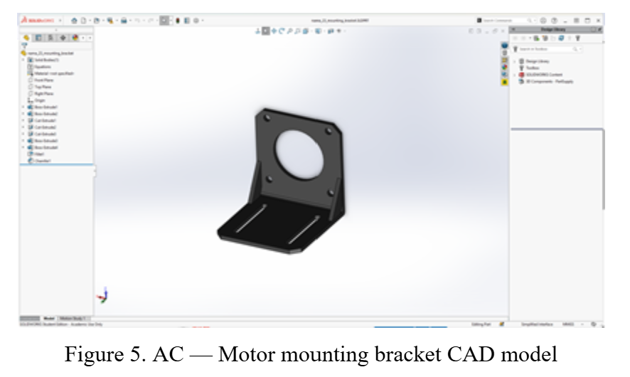
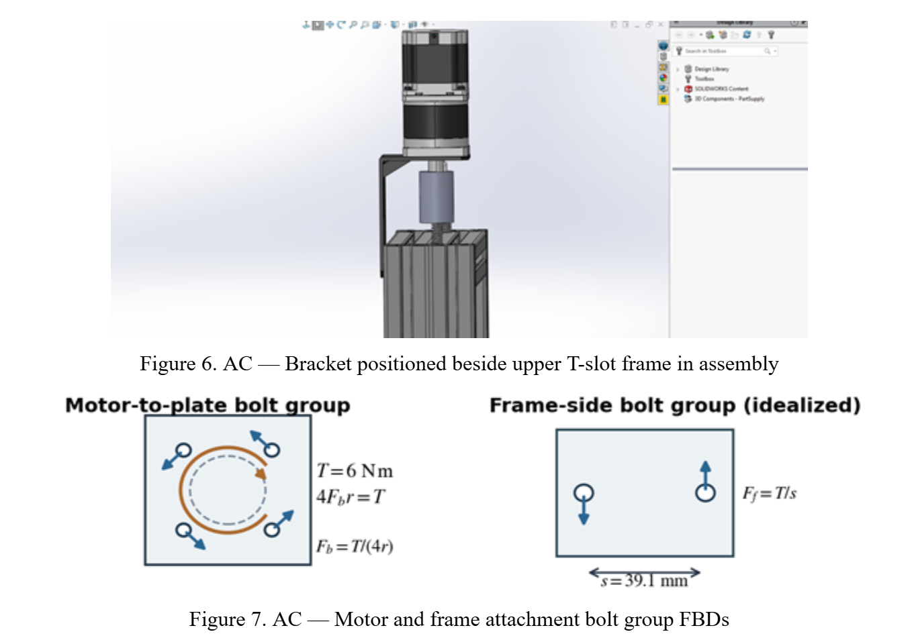

Verification note: The 3 mm thickness passes the local bolt-bearing analysis, but joint preload, plate bending under reaction torque, prying, actual fastener grade and rail attachment require final verification. Motor holes are nominal Ø5.0 mm; confirm bolt clearance before fabrication.

### Coupler Design (10 points)
The custom unequal-bore coupler is modeled in SolidWorks to connect the geared motor output to the 3/8-inch lead screw. Motor-side torque transfer uses the existing keyed shaft. A radial M5 × 0.8 set screw is modeled on the lead-screw side, intended to contact a shallow flat near the shaft end.

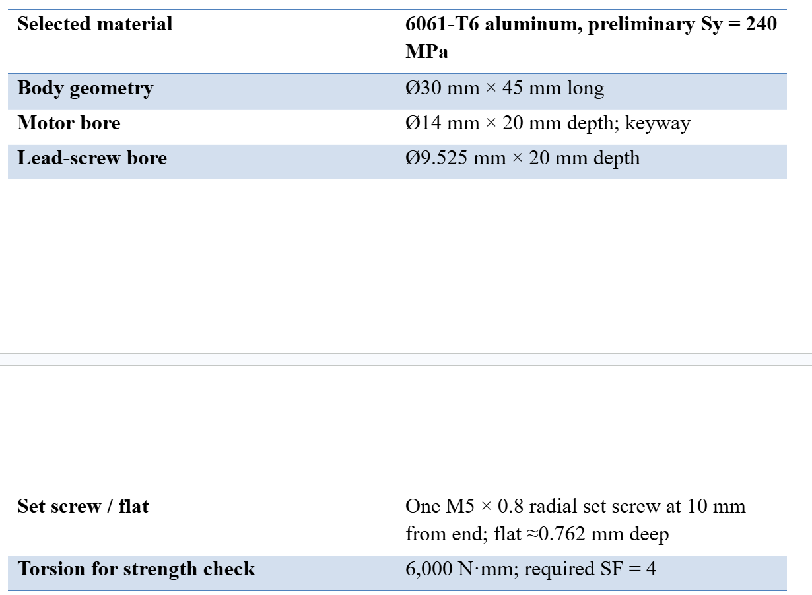
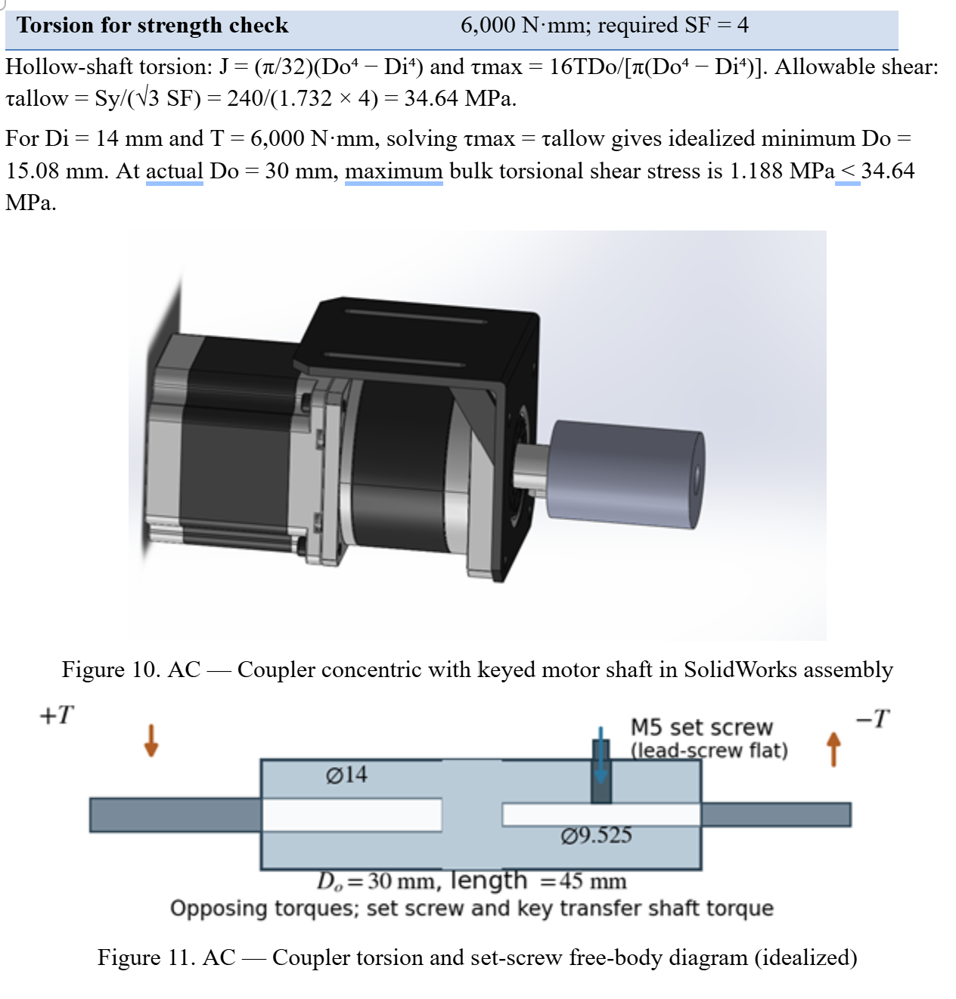
Figure 11. AC — Coupler torsion and set-screw free-body diagram (idealized)

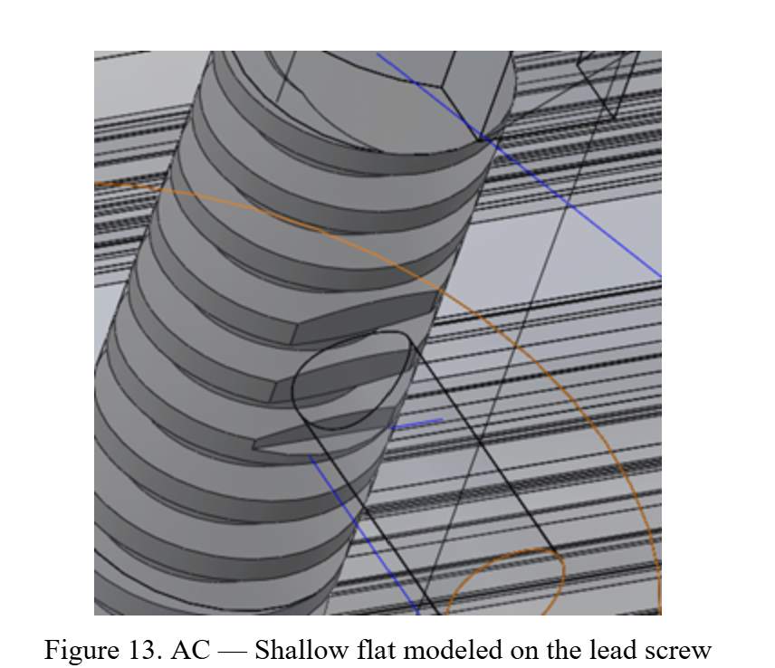

Verification note: A body torsion pass does not verify the single set screw. A friction-only model at µ = 0.20 and effective radius 4 mm requires N ≈ 4,395 / (0.20 × 4) = 5.49 kN normal force; this is not independently validated for an M5 set screw into 6061-T6 threads. Motor keyway stress concentration, shaft-tip contact, and lead-screw thrust bearing support remain open verification items.

 ### Engineering Lessons and Handoff
The CAD fit-up revealed that aligning the motor and coupler did not guarantee that the L-shaped bracket could reach or clear the upper frame rail. The bracket had to be checked in the real assembly and reoriented. The coupler analysis also separated bulk material strength from connection reliability: a very low torsional shear stress does not prove that a set screw can hold torque on a threaded lead screw.
Available to integrate: Motor/bracket/coupler subassembly screenshots; revised bracket, coupler, and lead-screw STEP models; the three detailed one-page calculation sheets; and the manufacturer motor curve. The final BOM must use actual purchase quotations and verified labor hours rather than estimated completion claims.
The separate three-page calculation sheets, supplied in the package, contain the detailed A10-style equations and diagrams. Numbered image files 122.png (motor), 126.png (mount), and 130.png (coupler) can be inserted into the shared document if the group wants the full calculation pages in addition to this copy-ready narrative.

### Frame Connections, Bracket Design, and Top Frame FEA - Bekah 

Design Responsibilities: Structural frame connections, motor twisting analysis, mounting bracket design, and top frame structural verification.
Design Objective
The objective of this portion of the project is to design and analyze the structural connections between the vertical supports and the top frame of the tensile tester. The frame must support the applied tensile loads while maintaining sufficient strength and stiffness to prevent excessive bending, twisting, or deformation during operation.
The analysis focuses on the forces and moments transferred from the two motors into the frame, the structural integrity of the mounting brackets and fasteners, and the ability of the top frame to withstand the applied loading conditions. Hand calculations and free-body diagrams are used to determine the forces and moments acting on the connections. SolidWorks Simulation is then used to evaluate the top frame through finite element analysis (FEA), including von Mises stress, displacement, factor of safety, and mesh convergence.

### Known and Unknown Variables

The following known variables were identified before beginning the frame connection and structural analysis, and the variables that must be determined through engineering calculations or SolidWorks Simulation.

### Frame Connection and Motor Twisting Analysis
\
The tensile tester uses two identical stepper motors positioned above the lead screw system. Both motors are mounted with their shafts oriented vertically downward. The center-to-center spacing between the motor and vertical support locations is 9.62 inches.
Each motor drives a lead screw that contributes to the movement of the crosshead. The two lead screws share the required tensile load, resulting in an axial load path of 1,000 N per lead screw under the 2,000 N maximum loading condition.
In addition to the axial loading, the motor mounting arrangement introduces reaction torques into the frame. These reaction torques must be considered because they can cause twisting or warping of the top extrusion and place additional loading on the mounting brackets.

### Motor Specifications

The selected motor is the STEPPERONLINE 23HS22-2804S-HG10 NEMA 23 stepper motor with a 10:1 planetary gearbox.
**Motor Specifications**

| Motor Specification | Value | Units |
|---|---:|---|
| Motor holding torque | 1.03 | N·m |
| Gearbox ratio | 10:1 | - |
| Gearbox efficiency | 92 | % |
| Theoretical gearbox output torque | 9.476 | N·m |
| Maximum permissible gearbox output torque | 6 | N·m |
| Motor phase current | 2.8 | A |
| Motor phase resistance | 0.9 | Ω |
| Gearbox backlash | ≤30 | Arcmin |

The theoretical gearbox output torque is calculated using:

$$
T_{out}=T_{motor}\times G\times\eta
$$

Substituting the motor specifications:

$$
T_{out}=1.03(10)(0.92)
$$

$$
\boxed{T_{out}=9.476\text{ N}\cdot\text{m}}
$$

However, the gearbox has a maximum permissible output torque of 6 N·m. Therefore, the actual output torque must not exceed this gearbox rating.

Important: The 1.03 N·m motor value is holding torque, not confirmed running torque. The actual operating torque depends on motor speed and the torque-speed curve. The final FEA moment must be based on the verified operating or design reaction torque, rather than automatically assuming the holding torque is available during operation.

### Equilibrium Equations
The reaction forces and moments are determined using static equilibrium.
Sum of forces in the horizontal direction:

**Sum of forces in the x-direction:**

$$
\sum F_x=0
$$

**Sum of forces in the vertical (y) direction:**

$$
\sum F_y=0
$$

**Sum of forces in the z-direction:**

$$
\sum F_z=0
$$

**Sum of moments about the x-axis:**

$$
\sum M_x=0
$$

**Sum of moments about the y-axis:**

$$
\sum M_y=0
$$

**Sum of moments about the z-axis:**

$$
\sum M_z=0
$$

The equations are applied to the individual motor connections, vertical supports, and top frame to determine the reaction forces and moments at each connection.
Mounting Bracket Design and Analysis
The mounting brackets connect the vertical supports to the 40 Series T-slot frame. These connections must resist the forces and moments transferred from the motor and lead screw system while maintaining proper alignment of the tensile tester.
The selected bracket is the McMaster-Carr 5537T348 90-degree extended corner bracket. The bracket is manufactured from powder-coated 6063-T5 aluminum and includes M8 mounting hardware.

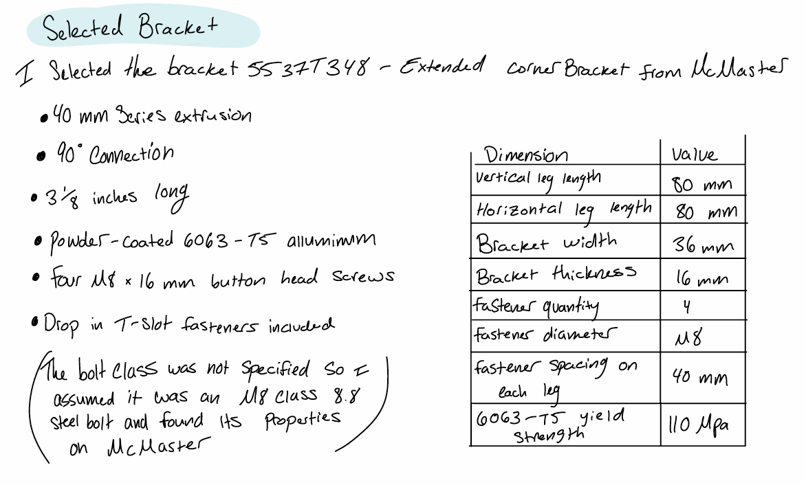

### Bracket Free-Body Diagram

The bracket FBD is used to determine the forces transferred through the mounting bolts and the resulting bending moment in the bracket. The applied force and moment arm must be measured from the actual bracket geometry and connection location.
Bracket Bending Stress
The bending moment is calculated using:

The bending moment is calculated using:

$$
M=F L
$$

Where:

- \(M\) = bending moment (N·mm)
- \(F\) = applied force (N)
- \(L\) = perpendicular distance from the bolt-group reference point to the force line of action (mm)

For a simplified rectangular cross-section, the section modulus is:

### Bracket Bending Stress

The bending moment is calculated using:

$$
M=FL
$$

Where:

- \(M\) = bending moment (N·mm)
- \(F\) = applied force (N)
- \(L\) = perpendicular distance from the bolt-group reference point to the force line of action (mm)

For a simplified rectangular cross-section, the section modulus is:

$$
S=\frac{bt^2}{6}
$$

Where:

- \(b\) = section width (mm)
- \(t\) = section thickness (mm)

The bending stress is calculated using:

$$
\sigma_b=\frac{M}{S}
$$

The calculated bending stress is compared with the appropriate material strength to evaluate the bracket's ability to withstand the applied load.

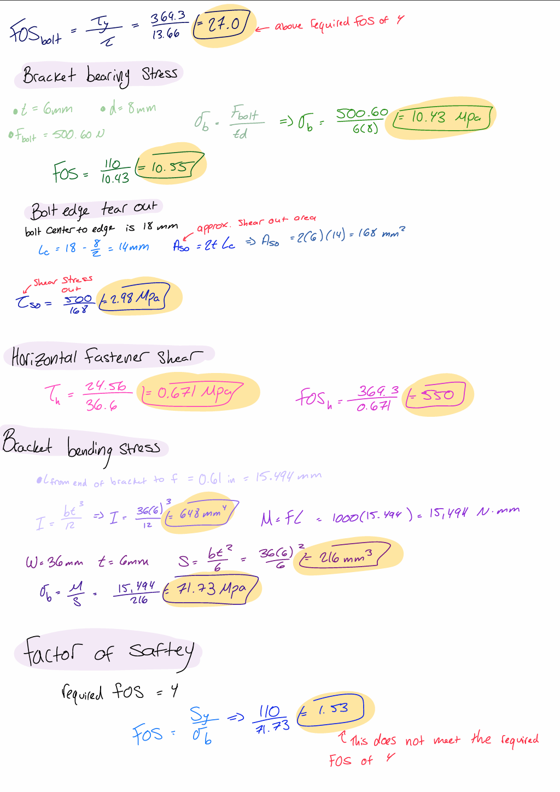

### Top Frame Geometry and Material

| **Specification** | **Value** |
|---|---:|
| Extrusion series | 40 Series |
| Material | 6061-T6 aluminum |
| Profile width | 1.575 in |
| Profile height | 1.575 in |
| Length | 12 in |
| Slot width | 0.320 in |
| Slot depth | 0.485 in |
| Center hole diameter | 0.276 in |
| Motor/support spacing | 9.62 in |

### Material Properties

The preliminary material properties used for the 6061-T6 aluminum extrusion are:

| **Material Property** | **Value** | **Units** |
|---|---:|---|
| Yield strength | 35,000 | psi |
| Elastic modulus | 10,000,000 | psi |
| Poisson's ratio | 0.33 | - |

The final material properties should be checked against the extrusion manufacturer's specifications.

For a required factor of safety of 4, the preliminary allowable stress is calculated using:

$$
\sigma_{allow}=\frac{S_y}{FOS}
$$

Substituting the material yield strength and required factor of safety:

$$
\sigma_{allow}=\frac{35,000}{4}
$$

$$
\boxed{\sigma_{allow}=8,750\text{ psi}}
$$

This allowable stress provides a preliminary comparison value for evaluating the FEA results.

## Top Frame Finite Element Analysis (FEA)

SolidWorks Simulation is used to evaluate the structural performance of the top frame under the expected operating loads. The simulation provides a visual representation of the stress distribution and displacement throughout the extrusion.

The analysis focuses on determining whether the top frame can withstand the applied forces and motor reaction moments without exceeding the allowable stress or deformation limits.

### Final FEA Results

The final simulation results will be compared with the preliminary allowable stress of 8,750 psi and the design requirements to determine whether the top frame meets the structural design criteria.

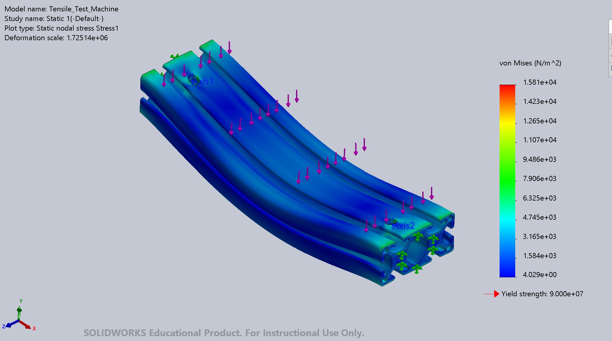

The factor of safety based on the maximum von Mises stress is calculated using:

$$
FOS=\frac{S_y}{\sigma_{von\ Mises}}
$$

Substituting the preliminary yield strength of 6061-T6 aluminum:

$$
FOS=\frac{241.3\text{ MPa}}{\sigma_{von\ Mises}}
$$

### FEA Results Discussion

The von Mises stress plot is used to identify the locations experiencing the highest stress under the applied loading conditions. These locations are important because they indicate potential areas where yielding may occur.

The displacement plot is used to evaluate how much the top frame deforms under the applied loads. Excessive displacement could affect the alignment of the lead screws and crosshead, potentially reducing the accuracy and functionality of the tensile tester.

The motor reaction moments are also considered because they may cause twisting or warping of the extrusion. The displacement results should be examined to determine whether the frame experiences significant rotational deformation in addition to bending.

### Design Improvements and Optimization
After reviewing the hand calculations and FEA results, potential design improvements are identified to improve the structural performance of the top frame and mounting connections.
Possible improvements include:
Adjusting the mounting bracket configuration.
Increasing bracket thickness or changing the bracket geometry.
Reducing the distance between the applied load and the bracket connection where possible.
Improving the spacing or arrangement of the frame supports.
Adding additional structural support to reduce twisting.
Revising the motor mounting arrangement to reduce the moment transferred into the frame.

I spent 6 hours on this assignment.

### Vertical Frame FEA- Farima Pournia 
* For this part for the assignment I conducted FEA on the vertical components of the frame in order to analyze the effect forces will have on our frame. I used Solidworks to conduct this analysis and run my simulation. I first isolated one of the vertical columns in CAD and then assigned the correct material of 6063-T4 Aluminum then proceeded to assign two forces to the column. I applied one axial compression force of 2 kN as a result of the top of the frame pushing down on the column. The second force I added to the simulation was the torque of 6 N that the motor will exert on the column, this force was added to the side of the column around the center axis. After assigning my forces I proceeded to add in a fixed fixture for the bottom of the column.

In order to run a convergence check I ran two simulations with two different types of mesh. My first simulations started out with a mesh sizing directly in between fine and coarse mesh size. After running the sim gathered data about the stress scene that showed the variation of stress across the whole column. This scene showed that the max stress was located at the bottom corner of the column at around a value of 6x10^6 N/m^2. The next scene I look at was deflection across the column at around 0.14 mm. The max deflection was at the top corner where the compressive force is being applied also at the same corner where the max stress was. The next scene that was created was a safety factor scene that allowed me to see how close our design material and vertical column was close to the limit of the safety factor for this design. The entire column was well within the safety factor. 

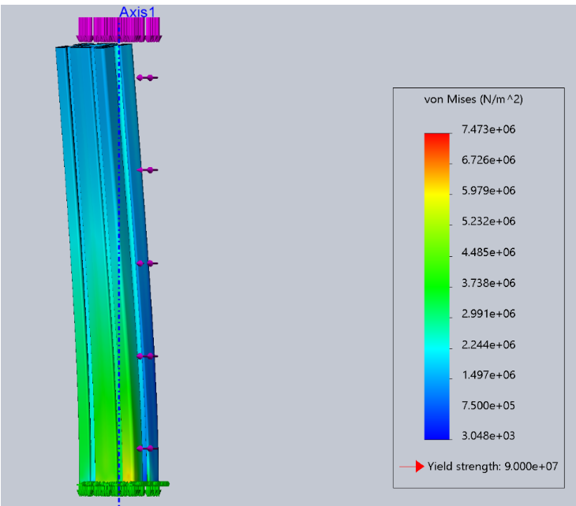
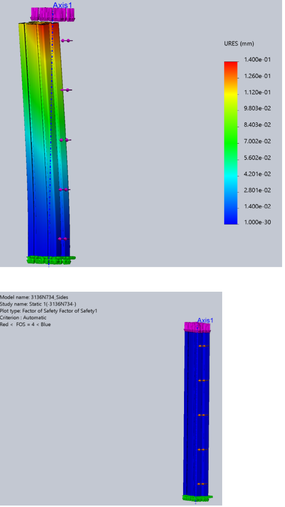

For my second simulation I ran a more fine type of mesh in order to complete my convergence check. This time I made the mesh size halfway between the middle and fine mesh size, this should give us more accurate results in the simulation. After the simulation I analyzed different scenes that were shown. The first one I analyzed was the stress scene which showed a max stress of 6.25x10^6 at the bottom corner which is at the same location of the previous sim. The second scene I looked at was deflection in the column. The max deflection is 0.14 mm at the top corner of the column at the same point above where the max stress is, this looks very similar to the other simulation that was ran but with a higher area of max deflection. The safety factor of the column is met in all locations which is confirmed by the safety factor scene shown, which also matches with the other simulation. 

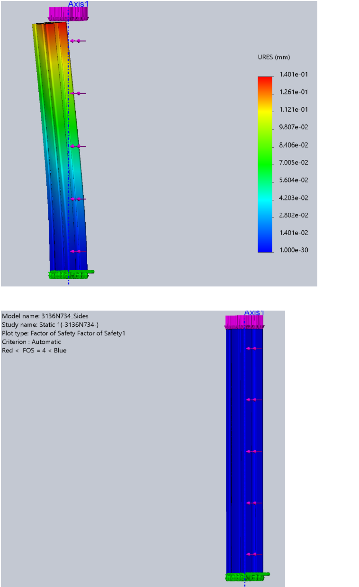

Overall the simulations between the two different types of meshes matched up results very well. The locations of the max forces and deformation lined up and the numbers of the maximum forces and deflection were within 5 percent of each other. The safety factors also looked exactly the same between the two meshes. One main difference that I noticed between a fine or coarse mesh was that a more fine mesh always calculated a higher deflection or stress and usually in a slightly larger area. The increase in cells allow the sim to be more accurate and to account for forces that may have been missed with a more coarse mesh. After running these simulations I noticed a couple of trends throughout the different scenes. One was that the location of the max stresses and deflections were always in the corner. Another was that the beam had a tendency to twist around it's axis starting from the top where the torque is first applied and decreasing till the bottom. Some changed to add in order to make the column more structural sound could be adding thicker flange pads at the top where the column experiences the most amount of torque. The most amount of deflection and stress was seen at the top of the column where the torque from the motor was experienced. 

### Floating Bearing Mount-Farima Pournia 
* To design the floating bearing mount, I made the thickness 0.25 inches. The length is 3 inches with a width of 2 inches that will fit on the aluminum bar. The mount has a hole in the middle for the lead screw is set to 0.3 inches with a tolerance of +- 0.0005 from the Machinery Handbook. There are 4 holes on the mount for #10 screw, the diameter of the screws is 0.2 inches. 

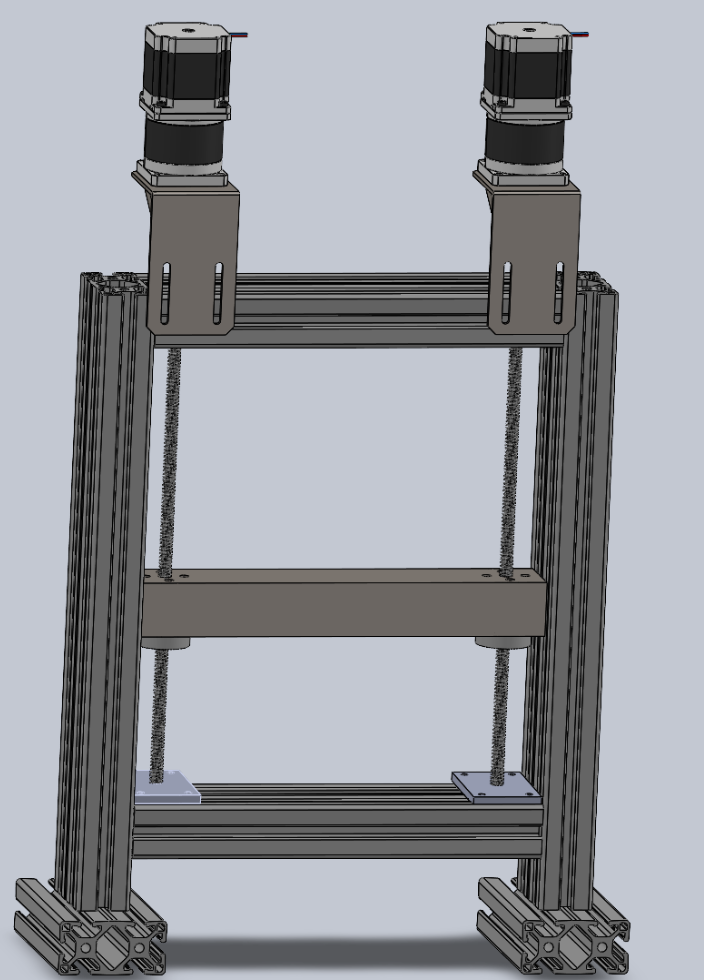

I spent 5 hours on this assignment. 

### Group work

## Bill of Materials and Labor Costs

### 1. Component Costs

| Item | Description | Quantity | Unit Cost | Total Cost |
|---|---|---:|---:|---:|
| 1 | McMaster-Carr 5537T348 mounting brackets | 4 | $13.21 | $52.84 |
| 2 | STEPPERONLINE 23HS22-2804S-HG10 stepper motors | 2 | $79.94 | $159.88 |
| | **Component Subtotal** | | | **$212.72** |

### 2. Labor Costs

The estimated labor rate for an entry-level mechanical engineering designer is $35.00 per hour. Each group member spent approximately 5–6 hours completing their assigned portion of the project.

| Group Member | Hours (Low) | Hours (High) | Hourly Rate | Labor Cost (Low) | Labor Cost (High) |
|---|---:|---:|---:|---:|---:|
| Person 1 – AC | 5 | 6 | $35.00 | $175.00 | $210.00 |
| Person 2 – Bekah | 5 | 6 | $35.00 | $175.00 | $210.00 |
| Person 3 – Farima | 5 | 6 | $35.00 | $175.00 | $210.00 |
| **Total Labor** | **15** | **18** | | **$525.00** | **$630.00** |

### 3. Combined Project Cost

| Cost Category | Minimum Cost | Maximum Cost |
|---|---:|---:|
| Components listed above | $212.72 | $212.72 |
| Engineering labor | $525.00 | $630.00 |
| **Total Project Cost** | **$737.72** | **$842.72** |

### 4. Average Labor Cost Calculation

For an estimated average of 5.5 hours per group member:

$$
\text{Total Labor Hours}=3(5.5)=16.5\text{ hours}
$$

$$
\text{Labor Cost}=16.5(35)=\$577.50
$$

$$
\text{Combined Cost}=212.72+577.50
$$

$$
\boxed{\text{Combined Cost}=\$790.22}
$$

### Group Work

## Bill of Materials (BOM) and Engineering Labor Cost

### Bill of Materials

The bill of materials (BOM) identifies the components selected for the tensile tester and their associated costs. The following table includes the components that have been selected and priced so far.

| Component | Part Number | Quantity | Unit Cost | Total Cost |
|---|---|---:|---:|---:|
| 90° Extended Corner Bracket | McMaster-Carr 5537T348 | 4 | $13.21 | $52.84 |
| NEMA 23 Stepper Motor with 10:1 Gearbox | STEPPERONLINE 23HS22-2804S-HG10 | 2 | $79.94 | $159.88 |
| **Current Component Subtotal** | | | | **$212.72** |

*Note: The corner brackets include the required M8 mounting hardware. The listed component subtotal represents the components priced so far and does not represent the final cost of the complete tensile tester.*

### Engineering Labor Cost

Engineering labor costs were estimated using an entry-level mechanical engineering designer rate of **$35 per hour**. Each group member spent approximately 5–6 hours completing their assigned design, calculations, CAD modeling, and analysis tasks.

| Group Member | Assigned Work | Estimated Hours | Hourly Rate | Estimated Labor Cost |
|---|---|---:|---:|---:|
| Person 1 (AC) | Motor selection, motor mount design, and coupler design | 5–6 | $35 | $175–$210 |
| Person 2 (Bekah) | Frame connections, mounting bracket calculations, and top frame FEA | 5–6 | $35 | $175–$210 |
| Person 3 (Farima) | Vertical frame FEA and floating bearing mount design | 5–6 | $35 | $175–$210 |
| **Total** | | **15–18** | | **$525–$630** |

### Estimated Project Cost

The estimated project cost combines the current component subtotal with the estimated engineering labor cost.

| Cost Category | Estimated Cost |
|---|---:|
| Current Component Subtotal | $212.72 |
| Engineering Labor | $525.00–$630.00 |
| **Estimated Total** | **$737.72–$842.72** |

Using the midpoint estimate of 5.5 labor hours per group member, the group spent approximately 16.5 hours on the project. This results in an estimated labor cost of $577.50 and a current combined project cost of **$790.22**.

## Decide

The Decide section presents the final design decisions made by the group based on the research, engineering calculations, free-body diagrams, and simulation results completed during the Analyze phase. The purpose of this section is to explain how the group evaluated the available design options, selected the mechanical components, and determined the final configuration of the tensile testing machine. Each group member contributed to the final design by selecting and evaluating the components associated with their assigned responsibilities.

The first part of the design selection focuses on the motor and drive system. The group selected two STEPPERONLINE 23HS22-2804S-HG10 NEMA 23 stepper motors with integrated 10:1 planetary gearboxes to drive the two lead screws. Each motor drives one 3/8-10 right-hand single-start Stub Acme lead screw, allowing the movable crosshead to travel vertically while maintaining a balanced loading arrangement. Custom couplers made from 6061-T6 aluminum were designed to connect the motor shafts to the lead screws. A gusset-reinforced motor mounting bracket was also developed to support each motor and provide a rigid connection to the frame. These components were selected based on the required crosshead speed, torque requirements, available space, and compatibility with the overall machine design. The torque calculations were used to evaluate whether the selected motor and gearbox configuration could provide the required driving torque while remaining below the gearbox's maximum permissible output torque.

The structural frame and connection components were selected to provide sufficient support and stability under the tensile testing machine's maximum design load of 2 kN. The group selected 40 Series T-slot aluminum extrusion for the frame because it provides a modular structure that can be assembled and adjusted using standard mounting hardware. McMaster-Carr 5537T348 extended 90-degree corner brackets with M8 mounting hardware were selected for the frame connections. The motor mounting configuration and frame spacing were also considered to ensure proper alignment between the motors, lead screws, and crosshead. Engineering calculations were performed to evaluate the loading on the brackets and fasteners, while SolidWorks Simulation was used to investigate the structural behavior of the top frame and potential twisting caused by motor reaction torque.

The vertical frame and floating bearing mount were also evaluated to ensure proper support and alignment of the lead screw system. The vertical frame was modeled using 6063-T4 aluminum and evaluated in SolidWorks Simulation under a 2 kN axial compressive load and a 6 N·m applied torque. Multiple mesh sizes were used to evaluate mesh convergence and determine whether the stress and displacement results remained consistent. The results showed that the maximum stress changed by less than 5% between the two mesh studies, while the maximum displacement remained approximately 0.14 mm. Based on the simulation results and the factor-of-safety evaluation, the selected column configuration was considered acceptable for the modeled loading conditions. A floating bearing mount was also designed to support the lead screw while allowing the bearing arrangement to accommodate the intended assembly configuration.

After evaluating the individual components, the group considered how the selected parts would function together as a complete tensile testing machine. The final design was reviewed using engineering calculations, free-body diagrams, SolidWorks Simulation, and CAD assembly checks. Particular attention was given to component alignment, mounting

## Communicate

### Lessons Learned

Throughout this project, our group gained a better understanding of the engineering design process and the importance of coordinating individual components to develop a complete tensile testing machine. Each group member was responsible for different portions of the design, including the motor and coupler system, structural frame connections, mounting brackets, vertical supports, and bearing mounts. Combining these individual designs required communication, coordination, and consideration of how each component would function within the complete assembly.

One of the most important lessons we learned was the importance of selecting components based on both their specifications and their intended operating conditions. During the motor selection process, we learned that a motor's holding torque does not necessarily represent the torque available during operation. We also learned that gearbox limitations, mechanical efficiency, and operating speed must be considered when selecting a drive system. Similarly, designing the motor mounting brackets and couplers demonstrated that a component passing a basic strength calculation does not automatically mean the entire connection is reliable. Fastener strength, contact forces, alignment, and connection geometry must also be evaluated.

Another important lesson involved structural analysis and the use of SolidWorks Simulation. Through the FEA of the top frame and vertical supports, we learned how applied forces, moments, material properties, fixtures, and mesh sizes influence simulation results. Comparing simulations with different mesh sizes helped us understand the importance of mesh convergence and checking whether the results remain consistent as the mesh becomes finer. We also observed that stress concentrations and maximum displacement often occur near corners, supports, and locations where loads are applied. These results showed us why identifying critical areas is important when evaluating structural integrity and considering design improvements.

We also learned the importance of using free-body diagrams and hand calculations before performing simulations. Breaking the tensile tester into individual components and analyzing the forces and moments acting on each connection helped us better understand the load paths throughout the machine. Calculations involving bending stress, bolt shear, bearing stress, tear-out, torsion, and factor of safety provided a foundation for evaluating whether the selected components could withstand the expected loading conditions. We learned that assumptions made during preliminary calculations must be verified against the actual component geometry, manufacturer specifications, and final assembly.

Finally, this project demonstrated the importance of teamwork and communication when completing a large engineering design. Dividing the work between three group members allowed us to focus on individual design responsibilities while contributing to the same overall objective. However, we also learned that individually completed components must be checked together in the final SolidWorks assembly to identify potential alignment, clearance, and connection issues. Sharing CAD models, calculations, and simulation results helped us combine our work into a more complete design.

Overall, this project strengthened our understanding of mechanical design, component selection, structural analysis, finite element analysis, and engineering documentation. It also taught us that successful engineering design requires more than designing individual components; every part must work together safely and effectively to meet the requirements of the complete system.

## CAD ZIP 

