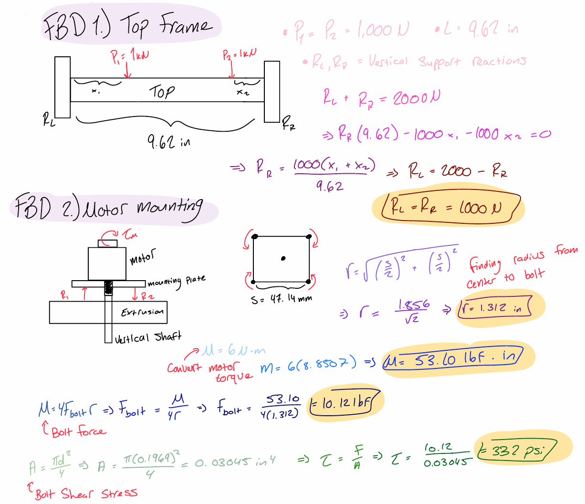
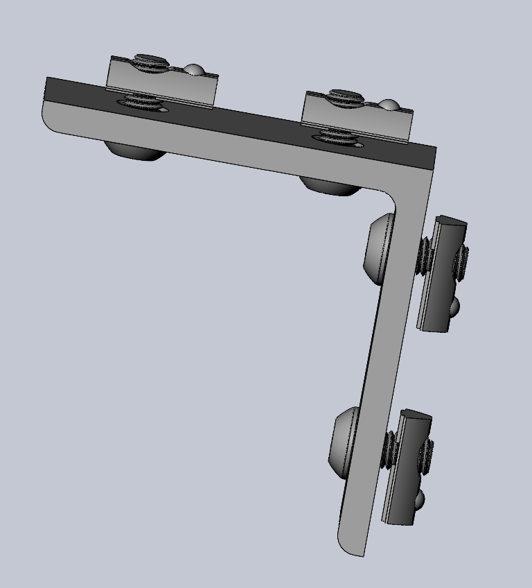
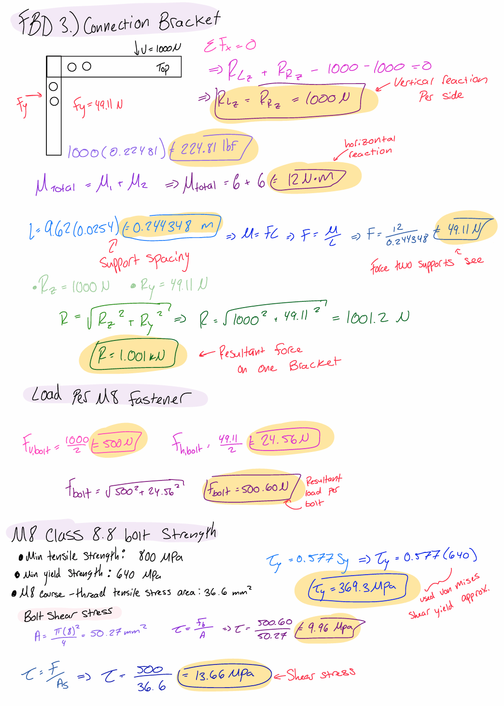
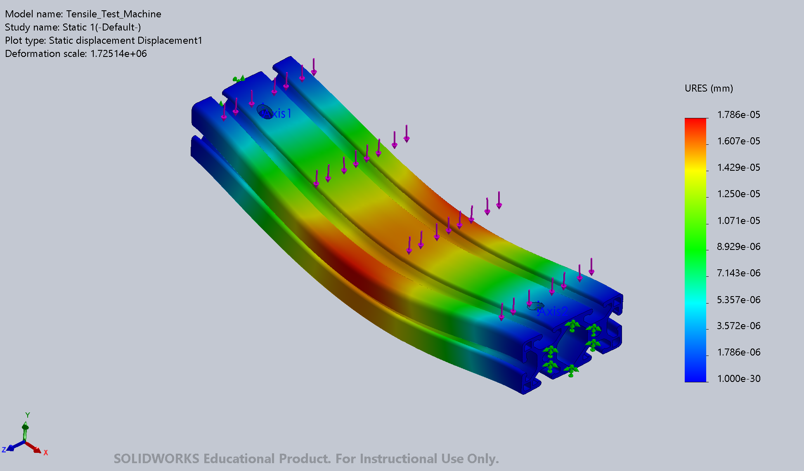
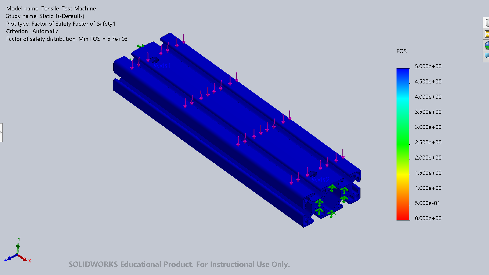
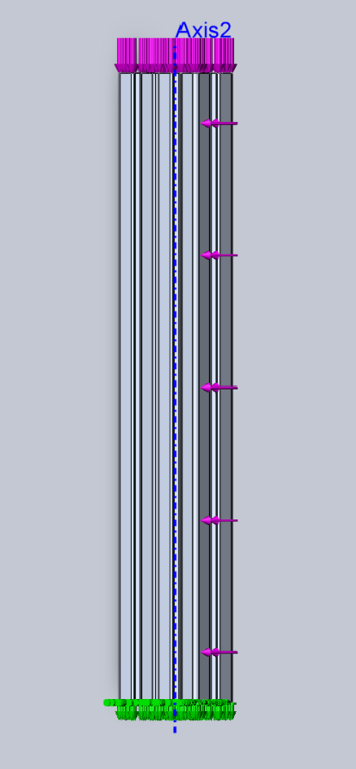
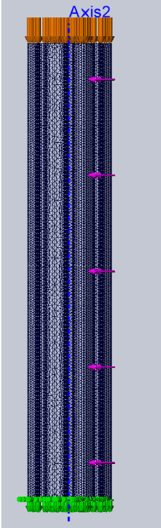
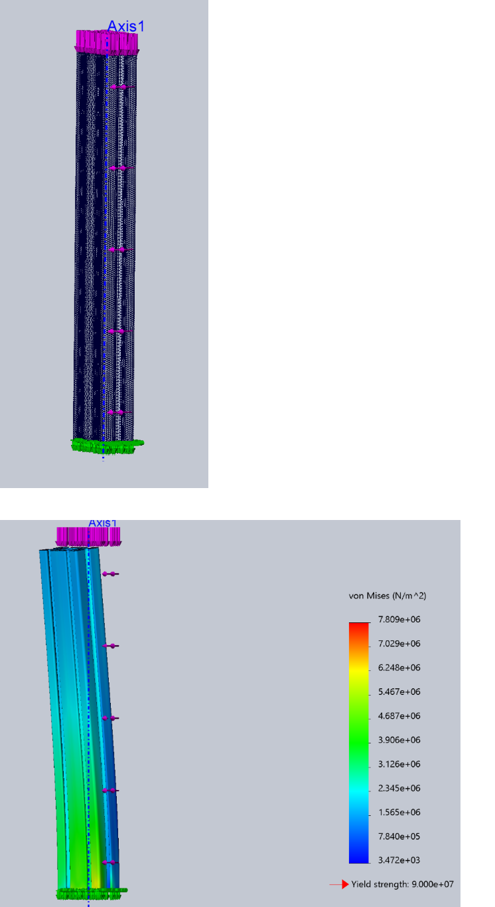
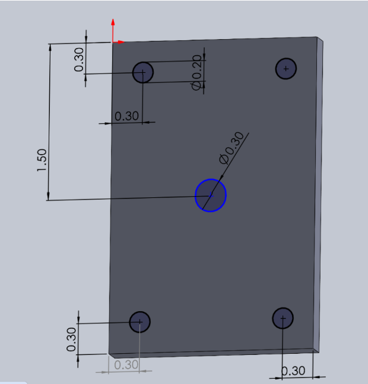

# A11 – Motor Selection

## Objective

The objective of this project is to design and develop a functional tensile testing machine capable of applying a maximum tensile load of 2 kN to evaluate the mechanical properties of materials. The design incorporates a lead screw drive system, stepper motors, a structural frame, a movable crosshead, and appropriate mounting components to safely and effectively apply the required load. The project involves selecting and sizing mechanical components, performing engineering calculations and free-body diagrams, evaluating structural integrity through finite element analysis (FEA), and creating a complete SolidWorks assembly. Each team member is responsible for specific portions of the design while collaborating on the final assembly, bill of materials, engineering costs, and project documentation. The final goal is to produce a complete, well-documented design that meets the project requirements while demonstrating the application of mechanical engineering principles.

## Analyze

### Frame Connections, Bracket Design, and Top Frame FEA - Bekah 

Design Responsibilities: Structural frame connections, motor twisting analysis, mounting bracket design, and top frame structural verification.
Design Objective
The objective of this portion of the project is to design and analyze the structural connections between the vertical supports and the top frame of the tensile tester. The frame must support the applied tensile loads while maintaining sufficient strength and stiffness to prevent excessive bending, twisting, or deformation during operation.
The analysis focuses on the forces and moments transferred from the two motors into the frame, the structural integrity of the mounting brackets and fasteners, and the ability of the top frame to withstand the applied loading conditions. Hand calculations and free-body diagrams are used to determine the forces and moments acting on the connections. SolidWorks Simulation is then used to evaluate the top frame through finite element analysis (FEA), including von Mises stress, displacement, factor of safety, and mesh convergence.

### Known and Unknown Variables

The following known variables were identified before beginning the frame connection and structural analysis, and the variables that must be determined through engineering calculations or SolidWorks Simulation.

### Frame Connection and Motor Twisting Analysis
\
The tensile tester uses two identical stepper motors positioned above the lead screw system. Both motors are mounted with their shafts oriented vertically downward. The center-to-center spacing between the motor and vertical support locations is 9.62 inches.
Each motor drives a lead screw that contributes to the movement of the crosshead. The two lead screws share the required tensile load, resulting in an axial load path of 1,000 N per lead screw under the 2,000 N maximum loading condition.
In addition to the axial loading, the motor mounting arrangement introduces reaction torques into the frame. These reaction torques must be considered because they can cause twisting or warping of the top extrusion and place additional loading on the mounting brackets.

### Motor Specifications

The selected motor is the STEPPERONLINE 23HS22-2804S-HG10 NEMA 23 stepper motor with a 10:1 planetary gearbox.
**Motor Specifications**

| Motor Specification | Value | Units |
|---|---:|---|
| Motor holding torque | 1.03 | N·m |
| Gearbox ratio | 10:1 | - |
| Gearbox efficiency | 92 | % |
| Theoretical gearbox output torque | 9.476 | N·m |
| Maximum permissible gearbox output torque | 6 | N·m |
| Motor phase current | 2.8 | A |
| Motor phase resistance | 0.9 | Ω |
| Gearbox backlash | ≤30 | Arcmin |

The theoretical gearbox output torque is calculated using:

$$
T_{out}=T_{motor}\times G\times\eta
$$

Substituting the motor specifications:

$$
T_{out}=1.03(10)(0.92)
$$

$$
\boxed{T_{out}=9.476\text{ N}\cdot\text{m}}
$$

However, the gearbox has a maximum permissible output torque of 6 N·m. Therefore, the actual output torque must not exceed this gearbox rating.

Important: The 1.03 N·m motor value is holding torque, not confirmed running torque. The actual operating torque depends on motor speed and the torque-speed curve. The final FEA moment must be based on the verified operating or design reaction torque, rather than automatically assuming the holding torque is available during operation.

### Equilibrium Equations
The reaction forces and moments are determined using static equilibrium.
Sum of forces in the horizontal direction:

**Sum of forces in the x-direction:**

$$
\sum F_x=0
$$

**Sum of forces in the vertical (y) direction:**

$$
\sum F_y=0
$$

**Sum of forces in the z-direction:**

$$
\sum F_z=0
$$

**Sum of moments about the x-axis:**

$$
\sum M_x=0
$$

**Sum of moments about the y-axis:**

$$
\sum M_y=0
$$

**Sum of moments about the z-axis:**

$$
\sum M_z=0
$$

The equations are applied to the individual motor connections, vertical supports, and top frame to determine the reaction forces and moments at each connection.
Mounting Bracket Design and Analysis
The mounting brackets connect the vertical supports to the 40 Series T-slot frame. These connections must resist the forces and moments transferred from the motor and lead screw system while maintaining proper alignment of the tensile tester.
The selected bracket is the McMaster-Carr 5537T348 90-degree extended corner bracket. The bracket is manufactured from powder-coated 6063-T5 aluminum and includes M8 mounting hardware.

### Bracket Free-Body Diagram

The bracket FBD is used to determine the forces transferred through the mounting bolts and the resulting bending moment in the bracket. The applied force and moment arm must be measured from the actual bracket geometry and connection location.
Bracket Bending Stress
The bending moment is calculated using:

The bending moment is calculated using:

$$
M=F L
$$

Where:

- \(M\) = bending moment (N·mm)
- \(F\) = applied force (N)
- \(L\) = perpendicular distance from the bolt-group reference point to the force line of action (mm)

For a simplified rectangular cross-section, the section modulus is:

### Bracket Bending Stress

The bending moment is calculated using:

$$
M=FL
$$

Where:

- \(M\) = bending moment (N·mm)
- \(F\) = applied force (N)
- \(L\) = perpendicular distance from the bolt-group reference point to the force line of action (mm)

For a simplified rectangular cross-section, the section modulus is:

$$
S=\frac{bt^2}{6}
$$

Where:

- \(b\) = section width (mm)
- \(t\) = section thickness (mm)

The bending stress is calculated using:

$$
\sigma_b=\frac{M}{S}
$$

The calculated bending stress is compared with the appropriate material strength to evaluate the bracket's ability to withstand the applied load.

### Top Frame Geometry and Material

| **Specification** | **Value** |
|---|---:|
| Extrusion series | 40 Series |
| Material | 6061-T6 aluminum |
| Profile width | 1.575 in |
| Profile height | 1.575 in |
| Length | 12 in |
| Slot width | 0.320 in |
| Slot depth | 0.485 in |
| Center hole diameter | 0.276 in |
| Motor/support spacing | 9.62 in |

### Material Properties

The preliminary material properties used for the 6061-T6 aluminum extrusion are:

| **Material Property** | **Value** | **Units** |
|---|---:|---|
| Yield strength | 35,000 | psi |
| Elastic modulus | 10,000,000 | psi |
| Poisson's ratio | 0.33 | - |

The final material properties should be checked against the extrusion manufacturer's specifications.

For a required factor of safety of 4, the preliminary allowable stress is calculated using:

$$
\sigma_{allow}=\frac{S_y}{FOS}
$$

Substituting the material yield strength and required factor of safety:

$$
\sigma_{allow}=\frac{35,000}{4}
$$

$$
\boxed{\sigma_{allow}=8,750\text{ psi}}
$$

This allowable stress provides a preliminary comparison value for evaluating the FEA results.

## Top Frame Finite Element Analysis (FEA)

SolidWorks Simulation is used to evaluate the structural performance of the top frame under the expected operating loads. The simulation provides a visual representation of the stress distribution and displacement throughout the extrusion.

The analysis focuses on determining whether the top frame can withstand the applied forces and motor reaction moments without exceeding the allowable stress or deformation limits.

### Final FEA Results

The final simulation results will be compared with the preliminary allowable stress of 8,750 psi and the design requirements to determine whether the top frame meets the structural design criteria.

The factor of safety based on the maximum von Mises stress is calculated using:

$$
FOS=\frac{S_y}{\sigma_{von\ Mises}}
$$

Substituting the preliminary yield strength of 6061-T6 aluminum:

$$
FOS=\frac{241.3\text{ MPa}}{\sigma_{von\ Mises}}
$$

### FEA Results Discussion

The von Mises stress plot is used to identify the locations experiencing the highest stress under the applied loading conditions. These locations are important because they indicate potential areas where yielding may occur.

The displacement plot is used to evaluate how much the top frame deforms under the applied loads. Excessive displacement could affect the alignment of the lead screws and crosshead, potentially reducing the accuracy and functionality of the tensile tester.

The motor reaction moments are also considered because they may cause twisting or warping of the extrusion. The displacement results should be examined to determine whether the frame experiences significant rotational deformation in addition to bending.

### Design Improvements and Optimization
After reviewing the hand calculations and FEA results, potential design improvements are identified to improve the structural performance of the top frame and mounting connections.
Possible improvements include:
Adjusting the mounting bracket configuration.
Increasing bracket thickness or changing the bracket geometry.
Reducing the distance between the applied load and the bracket connection where possible.
Improving the spacing or arrangement of the frame supports.
Adding additional structural support to reduce twisting.
Revising the motor mounting arrangement to reduce the moment transferred into the frame.

I spent 6 hours on this assignment.

### Vertical Frame FEA- Farima Pournia 
* For this part for the assignment I conducted FEA on the vertical components of the frame in order to analyze the effect forces will have on our frame. I used Solidworks to conduct this analysis and run my simulation. I first isolated one of the vertical columns in CAD and then assigned the correct material of 6063-T4 Aluminum then proceeded to assign two forces to the column. I applied one axial compression force of 2 kN as a result of the top of the frame pushing down on the column. The second force I added to the simulation was the torque of 6 N that the motor will exert on the column, this force was added to the side of the column around the center axis. After assigning my forces I proceeded to add in a fixed fixture for the bottom of the column.

In order to run a convergence check I ran two simulations with two different types of mesh. My first simulations started out with a mesh sizing directly in between fine and coarse mesh size. After running the sim gathered data about the stress scene that showed the variation of stress across the whole column. This scene showed that the max stress was located at the bottom corner of the column at around a value of 6x10^6 N/m^2. The next scene I look at was deflection across the column at around 0.14 mm. The max deflection was at the top corner where the compressive force is being applied also at the same corner where the max stress was. The next scene that was created was a safety factor scene that allowed me to see how close our design material and vertical column was close to the limit of the safety factor for this design. The entire column was well within the safety factor. 

For my second simulation I ran a more fine type of mesh in order to complete my convergence check. This time I made the mesh size halfway between the middle and fine mesh size, this should give us more accurate results in the simulation. After the simulation I analyzed different scenes that were shown. The first one I analyzed was the stress scene which showed a max stress of 6.25x10^6 at the bottom corner which is at the same location of the previous sim. The second scene I looked at was deflection in the column. The max deflection is 0.14 mm at the top corner of the column at the same point above where the max stress is, this looks very similar to the other simulation that was ran but with a higher area of max deflection. The safety factor of the column is met in all locations which is confirmed by the safety factor scene shown, which also matches with the other simulation. 

Overall the simulations between the two different types of meshes matched up results very well. The locations of the max forces and deformation lined up and the numbers of the maximum forces and deflection were within 5 percent of each other. The safety factors also looked exactly the same between the two meshes. One main difference that I noticed between a fine or coarse mesh was that a more fine mesh always calculated a higher deflection or stress and usually in a slightly larger area. The increase in cells allow the sim to be more accurate and to account for forces that may have been missed with a more coarse mesh. After running these simulations I noticed a couple of trends throughout the different scenes. One was that the location of the max stresses and deflections were always in the corner. Another was that the beam had a tendency to twist around it's axis starting from the top where the torque is first applied and decreasing till the bottom. Some changed to add in order to make the column more structural sound could be adding thicker flange pads at the top where the column experiences the most amount of torque. The most amount of deflection and stress was seen at the top of the column where the torque from the motor was experienced. 

### Floating Bearing Mount-Farima Pournia 
* To design the floating bearing mount, I made the thickness 0.25 inches. The length is 3 inches with a width of 2 inches that will fit on the aluminum bar. The mount has a hole in the middle for the lead screw is set to 0.3 inches with a tolerance of +- 0.0005 from the Machinery Handbook. There are 4 holes on the mount for #10 screw, the diameter of the screws is 0.2 inches. 

I spent 5 hours on this assignment. 

## Decide
_Reference your concept selection (Pugh matrix) here. How does this design follow from that decision?_

## Communicate
